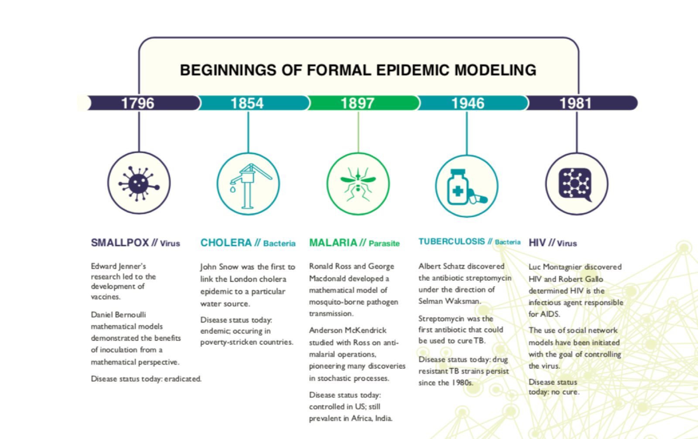
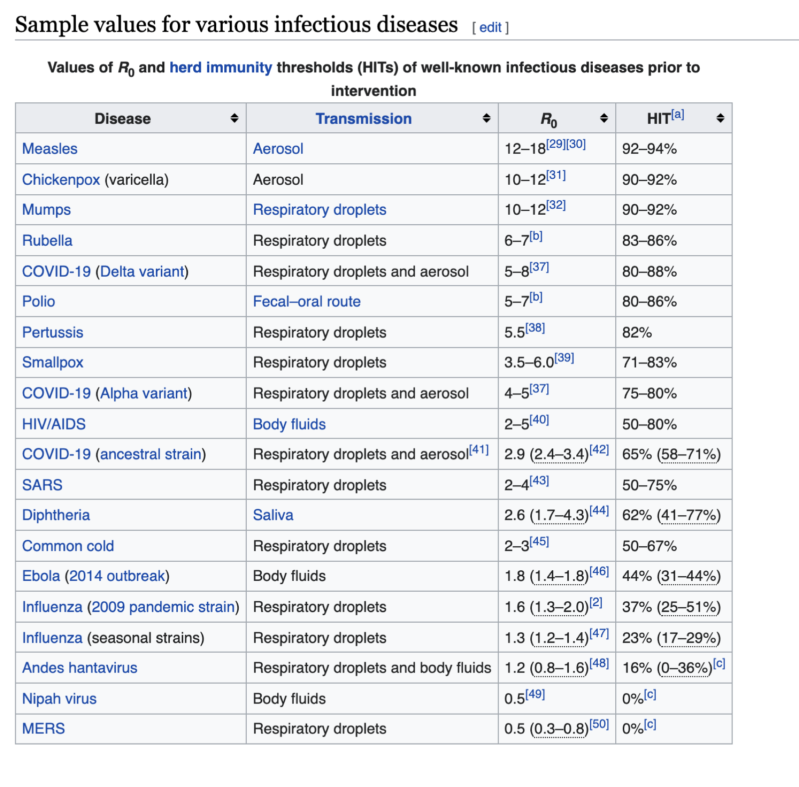
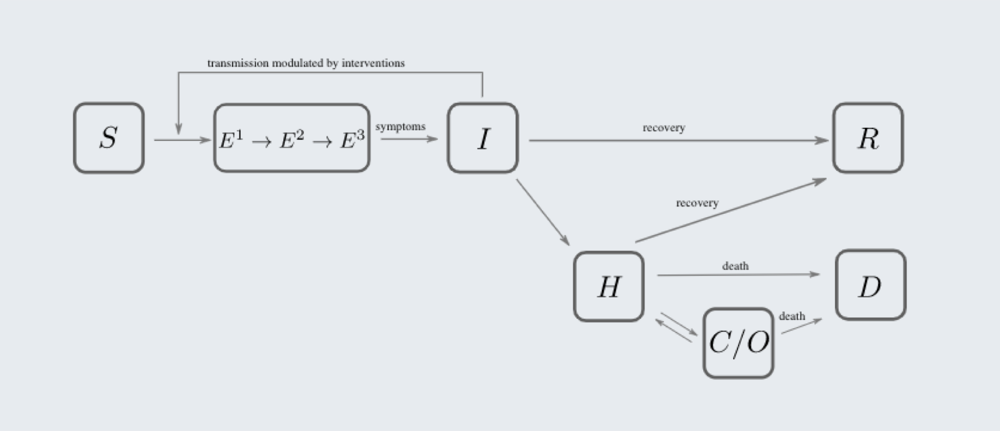
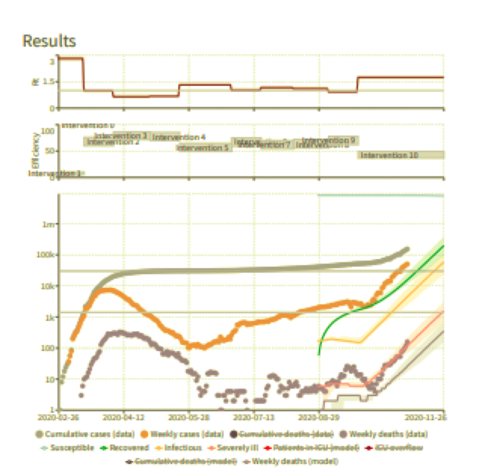
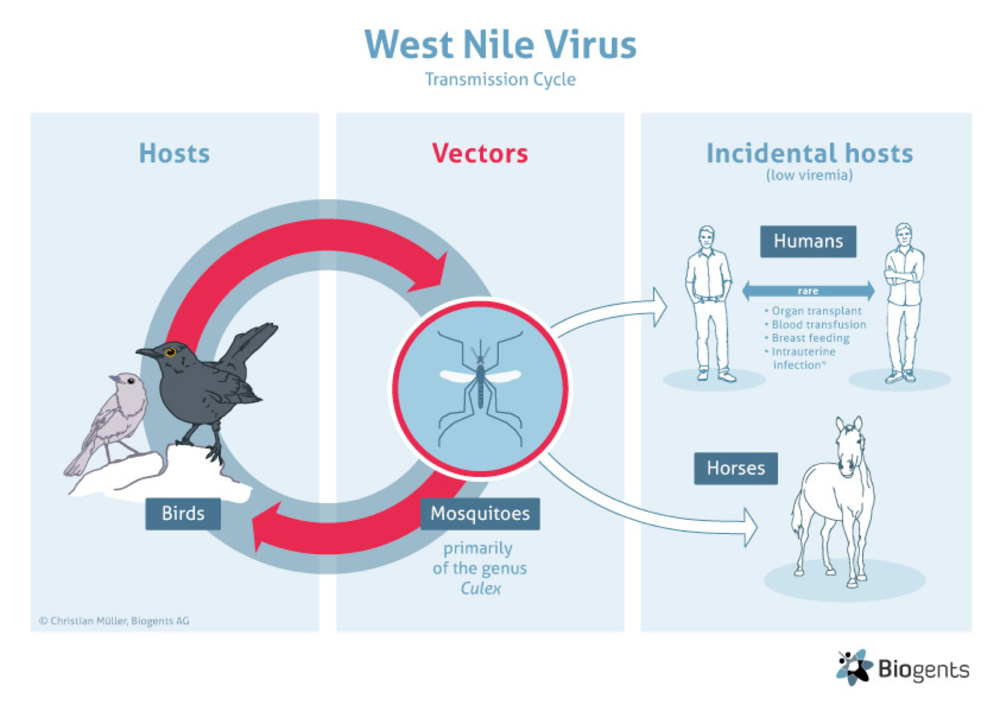
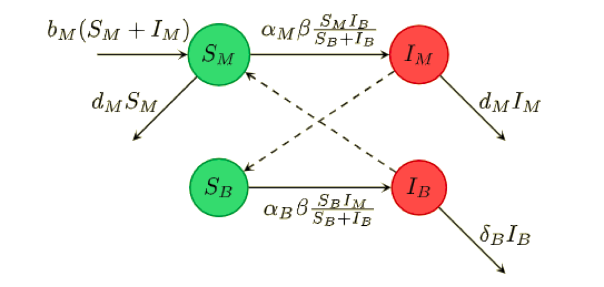
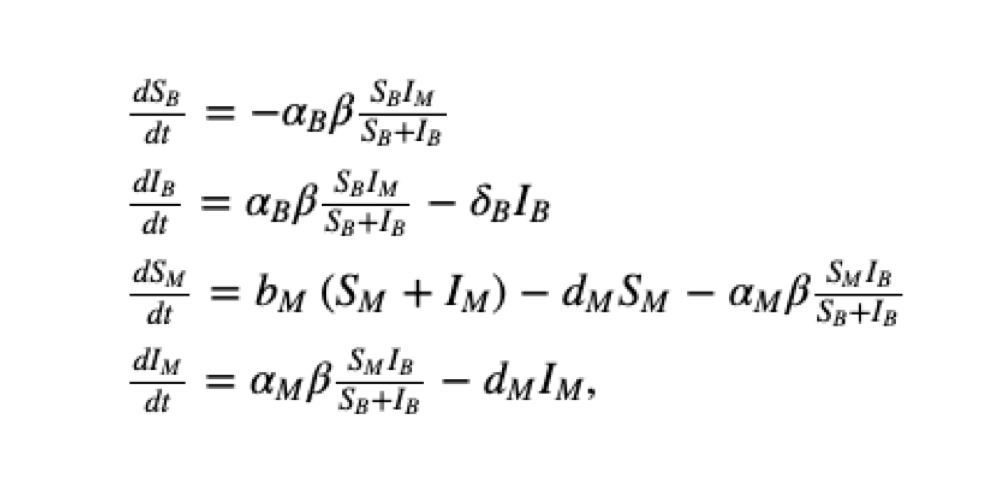
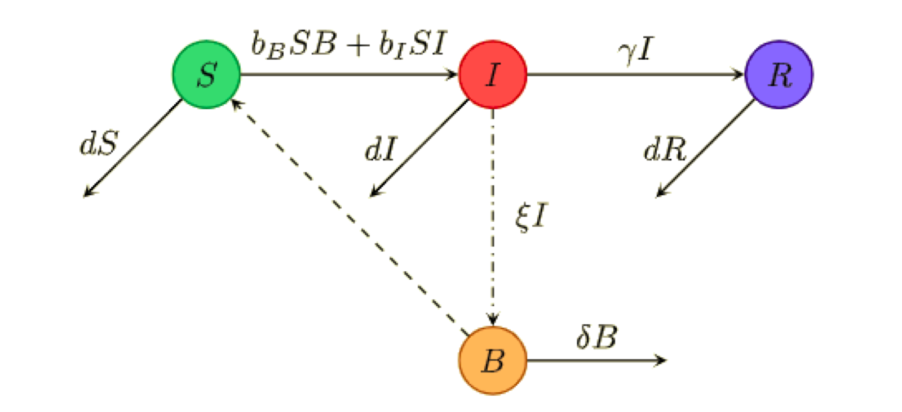
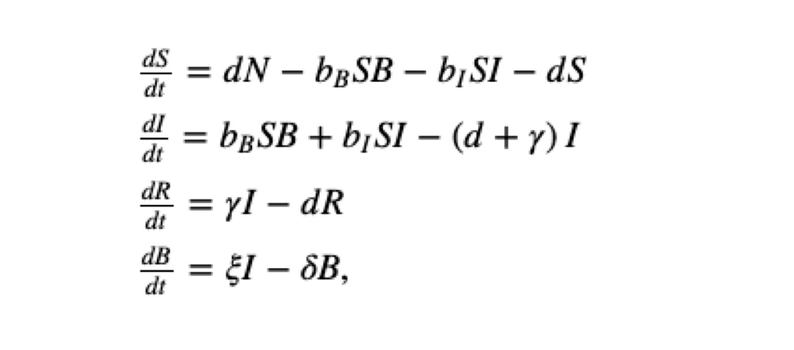

```{r}
#| label: setup
library(deSolve)
library(ggplot2)
library(tidyr)
theme_set(theme_classic(base_size = 22))
pal <- c(S = "#999999", E = "#CC79A7", I = "#E69F00", R = "#56B4E9")
sir <- function(t, x, p) with(as.list(c(x, p)),
  list(c(-beta * S * I, beta * S * I - gamma * I, gamma * I)))
```

# How this course works {background-color="#2C3E50"}

## Four Wednesdays {.smaller}

| Date | Lecture | Pitch |
|---|---|---|
| 25 Nov (9–12, 13–15) | L1 Compartment models, L2 Chance | 1: the question |
| 2 Dec (9–12) | L3 Pathogen evolution | 2: the model |
| 9 Dec (9–12) | L4 Space and data | 3: first result |
| 16 Dec (9–12) | — | Final presentations |

. . .

Every day: **lecture (1 h) → pitches (2–3 min per team) → work on your project.**

## Four model families, before you choose {.smaller}

| Family | Question | Tutorial |
|---|---|---|
| Compartment models | How does an epidemic unfold? | T1 |
| Branching processes | Does one infection, or one resistant cell, take off? | T2 |
| Pathogen evolution | Which strain wins? When does treatment select for resistance? | T3, T4 |
| Space and data | What changes with local contacts? What is $R_t$ right now? | T5, T6 |

. . .

You will have seen the first two by lunch today. Pitch 1 is at 13:00.

## Your project

Teams of 3–5. One **question**, answered with a model you build yourselves.

A good project has

1. **a question** in one sentence, ending with a question mark;
2. **a reference case**: the model *without* your new ingredient;
3. **a prediction**, written down before you run anything;
4. **one main figure** that answers the question.

. . .

Graded on the **final presentation** and a **written report** with code that reproduces every figure.

## AI tools: allowed, with three rules {.smaller}

1. **Be transparent.** Every presentation and report ends with a 2–6 sentence AI usage statement: which tools, for what, and how you checked the output.
2. **Understand everything.** You must be able to explain every line of code and every equation. Code you cannot explain counts as misconduct.
3. **Check every reference yourself.** A hallucinated paper is an automatic fail for the project.

. . .

Good uses: explanations, debugging, pseudocode, brainstorming. Ask for *explanations*, not just answers.

Full policy on the course website.

# Lecture 1 · Compartment models {background-color="#2C3E50"}

## What computational epidemiology is for

:::: {.columns}
::: {.column width="50%"}
**Before an epidemic**

- Which interventions work?
- Can an outbreak be contained?
- How many vaccines should be stockpiled?
:::
::: {.column width="50%"}
**During an epidemic**

- Estimate transmission parameters
- Interpret real-time trends
- Assess the impact of interventions
- Track new variants
:::
::::

. . .

Models are used for **understanding** (why does this happen?) and for **prediction** (what will happen?). This course is mostly about understanding.

## All models are wrong, but some are useful

Every model trades off **simplicity**, **accuracy** and **generality**.

- **Toy models:** simple and often solvable by hand. They build intuition for one new feature.
- **Realistic simulations:** many details, used for "experiments" we cannot do. Hard to understand why they behave as they do.
- **Simple general models:** capture the key features. They give simple results that explain a specific problem.

. . .

In your project, aim for the third kind. **Start simple, then add one ingredient.**

## A very short history

- **1760, Daniel Bernoulli:** a mathematical model of smallpox, used to show that inoculation increases life expectancy.
- **1911, Ronald Ross:** a model of malaria transmission. Reducing mosquitoes below a threshold eliminates the disease.
- **1927, Kermack & McKendrick:** the SIR model. An epidemic stops *before* everyone is infected.

. . .

The core ideas we use today, thresholds and $R_0$, come from these three.

## Beginnings of formal epidemic modelling {.smaller}

{fig-align="center" height="430"}

::: notes
Jenner/Bernoulli (smallpox), Snow (cholera, the first epidemiological map), Ross and Macdonald (malaria), Kermack and McKendrick, Anderson and May. Each step connects a disease to a modelling idea.
:::

## Compartments

Divide the population by **disease status**:

| | | |
|---|---|---|
| **S** | susceptible | can be infected |
| **I** | infected | infectious, can infect others |
| **R** | recovered (removed) | immune, or dead |

. . .

We follow the **proportions** $S(t)$, $I(t)$ and $R(t)$, with $S + I + R = 1$, and ignore what happens inside each host. Lecture 3 opens that box.

## Building the SIR model

How fast does $I$ change?

. . .

**Up:** susceptibles meet infecteds at a rate proportional to $S \cdot I$ (mass action), and a fraction of meetings transmits. Together: $\beta S I$.

. . .

**Down:** each infected person recovers at rate $\gamma$, so the mean infectious period is $1/\gamma$. Together: $\gamma I$.

. . .

$$
\frac{dS}{dt} = -\beta S I, \qquad
\frac{dI}{dt} = \beta S I - \gamma I, \qquad
\frac{dR}{dt} = \gamma I
$$

## Where $\beta S I$ comes from {.smaller}

Follow **one infected person** for a short time $\Delta t$:

. . .

- They make $c\,\Delta t$ contacts (contact rate $c$).
- A fraction $S$ of those contacts are susceptible.
- Each contact with a susceptible transmits with probability $p$.

. . .

New infections caused by this person: $c\,p\,S\,\Delta t$. With $I$ infected people:

$$
\text{new infections in } \Delta t = \underbrace{c\,p}_{\beta}\; S\, I\, \Delta t
$$

. . .

**Mass action** assumes contacts are random: anyone can meet anyone. Lecture 4 drops this.

## Where $\gamma I$ comes from {.smaller}

Each infected person recovers with probability $\gamma\,\Delta t$ in a short interval $\Delta t$, independently of how long they have been infected.

. . .

For a group of $I_0$ people infected at time 0, nobody new joining:

$$
\frac{dI}{dt} = -\gamma I \;\Rightarrow\; I(t) = I_0\, e^{-\gamma t}
$$

. . .

- The fraction still infectious after time $t$ is $e^{-\gamma t}$: the infectious period is **exponentially distributed**.
- Its mean is $\int_0^\infty e^{-\gamma t}\,dt = 1/\gamma$.

. . .

This is a modelling choice. Real infectious periods are less variable. SEIR models and models with several I stages fix this (later today).

## From time steps to differential equations {.smaller}

Over a short step $\Delta t$:

$$
I(t + \Delta t) = I(t) + \beta S I\, \Delta t - \gamma I\, \Delta t
$$

. . .

Rearrange and let $\Delta t \to 0$:

$$
\frac{I(t + \Delta t) - I(t)}{\Delta t} = \beta S I - \gamma I
\;\xrightarrow{\;\Delta t \to 0\;}\;
\frac{dI}{dt} = \beta S I - \gamma I
$$

. . .

Every flow out of one compartment is a flow into another, so $S + I + R = 1$ always:

$$
\frac{d}{dt}(S + I + R) = -\beta SI + (\beta SI - \gamma I) + \gamma I = 0
$$

## What is a solution?

A **solution** is a set of functions $S(t)$, $I(t)$, $R(t)$ that satisfy the equations for all $t$.

. . .

**One case we can solve by hand:** at the very start, $S \approx 1$:

$$
\frac{dI}{dt} \approx (\beta - \gamma)\, I
\quad\Rightarrow\quad
I(t) = I_0\, e^{(\beta - \gamma) t}
$$

The epidemic grows exponentially if $\beta > \gamma$.

. . .

For the full SIR model there is no simple closed form. We **solve it numerically**, in a few lines of R (T1).

## How a computer solves it: Euler's method {.smaller}

Read the time-step equation backwards: from today's state, compute tomorrow's.

```{r}
#| label: euler-code
#| echo: true
#| eval: false
for (step in 1:n_steps) {
  dS <- -beta * S * I
  dI <-  beta * S * I - gamma * I
  S  <- S + dS * dt
  I  <- I + dI * dt
}
```

. . .

```{r}
#| label: euler
#| fig-width: 11
#| fig-height: 3.4
euler <- function(dt, tmax = 30) {
  S <- 1 - 1e-6; I <- 1e-6; n <- round(tmax / dt)
  out <- data.frame(time = (0:n) * dt, I = NA_real_); out$I[1] <- I
  for (k in 1:n) {
    dS <- -2 * S * I; dI <- 2 * S * I - I
    S <- S + dS * dt; I <- I + dI * dt; out$I[k + 1] <- I
  }
  out
}
ref <- as.data.frame(ode(c(S = 1 - 1e-6, I = 1e-6, R = 0), seq(0, 30, 0.05), sir, c(beta = 2, gamma = 1)))
eu <- rbind(cbind(euler(1), method = "Euler, dt = 1"), cbind(euler(0.25), method = "Euler, dt = 0.25"))
ggplot() +
  geom_line(data = ref, aes(time, I, colour = "deSolve (adaptive)"), linewidth = 1.6) +
  geom_line(data = eu, aes(time, I, colour = method), linewidth = 1.1, linetype = "dashed") +
  scale_colour_manual(values = c("black", "#56B4E9", "#D55E00")) +
  labs(x = "Time", y = "I", colour = NULL)
```

Smaller steps converge to the true solution. `deSolve` picks the step size for you. Full walkthrough: [T0](../tutorials/00-solving-odes.qmd).

## One epidemic

```{r}
#| label: sir
#| fig-width: 11
#| fig-height: 5.2
out <- as.data.frame(ode(c(S = 1 - 1e-6, I = 1e-6, R = 0), seq(0, 40, 0.05), sir,
                         c(beta = 2, gamma = 1)))
long <- pivot_longer(out, -time, names_to = "comp", values_to = "x")
ggplot(long, aes(time, x, colour = comp)) +
  geom_line(linewidth = 1.6) +
  geom_hline(yintercept = 0.5, linetype = "dashed") +
  annotate("text", x = 36, y = 0.55, label = "S == 1/R[0]", parse = TRUE, size = 7) +
  scale_colour_manual(values = pal) +
  labs(x = "Time", y = "Proportion", colour = NULL,
       title = expression(list(beta == 2, gamma == 1, R[0] == 2))) +
  theme(plot.title = element_text(size = 20))
```

Infections peak exactly when $S$ drops to $1/R_0$.

## Try it yourself (5 min)

Open **[T0 — Solving differential equations in R](../tutorials/00-solving-odes.qmd)**, section 5, and use `run_sir()` and `plot_sir()`.

In pairs, predict first, then run:

1. What happens if you multiply $\gamma$ *or* $\beta$ by 2?
2. What happens if you multiply $\gamma$ *and* $\beta$ by 2? Can you explain it?
3. What are the equilibria of the system, the states where nothing changes?
4. Are they stable? What would "stable" mean here?
5. What would you change in the model to make the disease persist?

## Quick check

What happens if we **double both $\beta$ and $\gamma$**?

. . .

The epidemic has the **same shape** and the **same final size**, but runs **twice as fast**.

Only the ratio $\beta/\gamma$ decides *whether* and *how big*. The values themselves only set the time scale.

## The basic reproduction number $R_0$ {.smaller}

> The expected number of secondary cases caused by one infected individual in a fully susceptible population.

. . .

One infected person infects at rate $\beta S$ for an average time $1/\gamma$. With $S = 1$:

$$
R_0 = \frac{\beta}{\gamma}
$$

. . .

$\dfrac{dI}{dt} > 0 \iff \beta S > \gamma \iff S > \dfrac{1}{R_0}$

The epidemic can only grow while enough people are still susceptible.

## $R_0$ by counting one generation {.smaller}

Take one step of the length of an infectious period, $\Delta t = 1/\gamma$:

. . .

$$
I(t + 1/\gamma) \approx I + \beta S I \cdot \frac{1}{\gamma} - \gamma I \cdot \frac{1}{\gamma}
= \frac{\beta S}{\gamma}\, I
$$

. . .

- The old infecteds are gone (they recovered).
- Each was replaced by $\beta S/\gamma$ new ones.

So each infected person is replaced by $\beta S / \gamma$ others, which is $R_0 = \beta/\gamma$ when $S = 1$, and the **effective** reproduction number $R_t = R_0\, S(t)$ later on.

## How many get infected in the end? {.smaller}

Divide $dS/dt$ by $dR/dt$, and time drops out:

$$
\frac{dS}{dR} = \frac{-\beta S I}{\gamma I} = -R_0\, S
\quad\Rightarrow\quad
S = S_0\, e^{-R_0 R}
$$

. . .

At the end, $I = 0$, so the final size is $Z = R_\infty = 1 - S_\infty$. With $S_0 \approx 1$:

$$
\boxed{1 - Z = e^{-R_0 Z}}
$$

. . .

- This has no closed form, but is easy to solve numerically (`uniroot` in R).
- There is always a solution with $Z > 0$ when $R_0 > 1$. **Not everyone gets infected:** $S_\infty > 0$.

## How high is the peak? {.smaller}

Divide $dI/dt$ by $dS/dt$:

$$
\frac{dI}{dS} = \frac{\beta S I - \gamma I}{-\beta S I} = -1 + \frac{1}{R_0\, S}
$$

. . .

Integrate:

$$
I + S - \frac{\ln S}{R_0} = \text{const} = 1 \quad (\text{at the start: } S = 1, I = 0)
$$

. . .

The peak is at $S = 1/R_0$, so

$$
\boxed{I_{\max} = 1 - \frac{1 + \ln R_0}{R_0}}
\qquad R_0 = 2: \; I_{\max} \approx 15\%
$$

This matches the simulation (0.1534 for both).

## What herd immunity means

**The idea:** immune people do not just protect themselves. They also *block chains of transmission* to others.

An infected person meets others at random, and only a fraction $S$ of contacts can be infected: $R_t = R_0\, S$.

Once enough people are immune that $R_t < 1$, chains still start but **die out after a few infections**. A large epidemic is no longer possible, and non-immune people are protected *indirectly*:

$$
\text{immune fraction} > \boxed{1 - \frac{1}{R_0}}
$$

Example: $R_0 = 2.5$ needs 60% immune.

## What herd immunity does *not* mean {.smaller}

- **It is a threshold for growth, not a force field.** Above the threshold an introduced case still infects $R_t/(1-R_t)$ people on average, and close to the threshold these chains are long. Chains shrink instead of growing. Below it, partial immunity still helps: at 50% immunity and $R_0 = 2.5$, an unprotected person's risk falls from 89% to 37%.

. . .

- **Reaching it through infection costs more than the threshold.** The epidemic overshoots (next slide): at $R_0 = 2$ the threshold is 50%, but about 80% get infected.

. . .

- **It assumes random mixing.** National coverage above the threshold does not protect a *cluster* of unvaccinated people who mostly meet each other. Measles outbreaks in under-vaccinated communities are the classic example.

. . .

- **It is not a fixed number.** It moves with $R_0$: new variants, seasons and behaviour change it. Immunity can **wane**, so the immune fraction can slip back below the threshold.

. . .

- **Vaccines are not perfect.** With efficacy $E$, the coverage needed is $v_c = (1 - 1/R_0)/E$. For measles ($R_0 \approx 15$, $E \approx 0.97$) that is about 96%. If $v_c > 1$, vaccination alone cannot do it.

## Herd immunity threshold and final size

```{r}
#| label: hit
#| fig-width: 11
#| fig-height: 4.9
R0s <- seq(1.01, 6, length.out = 200)
Z <- sapply(R0s, function(R0) uniroot(function(z) z - (1 - exp(-R0 * z)), c(1e-6, 1))$root)
df <- rbind(data.frame(R0 = R0s, y = 1 - 1 / R0s, what = "herd immunity threshold 1 - 1/R0"),
            data.frame(R0 = R0s, y = Z, what = "final size Z = 1 - exp(-R0 Z)"))
ggplot(df, aes(R0, y, colour = what)) +
  geom_line(linewidth = 1.6) +
  scale_colour_manual(values = c("#56B4E9", "#E69F00")) +
  labs(x = expression(R[0]), y = "Proportion of population", colour = NULL) +
  theme(legend.position = "top", legend.direction = "vertical")
```

An unmitigated epidemic **overshoots** the herd immunity threshold: at $R_0 = 2$, 50% are needed but about 80% get infected.

## $R_0$ for real diseases {.smaller}

| Disease | $R_0$ (typical range) | Herd immunity threshold |
|---|---|---|
| Measles | 12–18 | 92–94% |
| SARS-CoV-2 (ancestral strain) | about 2.5–3 | about 60–67% |
| Seasonal influenza | about 1.3 | about 23% |

. . .

$R_0$ is **not** a property of the pathogen alone. It depends on contact patterns, population density, season and behaviour. The same pathogen has different $R_0$ in different places.

$R_t$ is the reproduction number *now*, with immunity and interventions. Lecture 4 estimates it from data.

::: notes
Measles range: Anderson & May 1991 (with the caveat from Guerra et al. 2017 that published values vary widely). Influenza: Biggerstaff et al. 2014, median about 1.28 for seasonal flu. Discussion: is "herd immunity" in public debate the same thing as the HIT here?
:::

## $R_0$ and herd immunity across diseases {.smaller}

{fig-align="center" height="430"}

Source: Wikipedia, "Basic reproduction number". Each value is a range from many studies, a reminder that $R_0$ depends on the population as much as on the pathogen.

## Equilibria

An **equilibrium** is a state where nothing changes: $dS/dt = dI/dt = dR/dt = 0$.

. . .

For SIR: every state with $I = 0$ is an equilibrium (any split between $S$ and $R$).

. . .

Is it **stable**? Add a few infected individuals:

- if $S > 1/R_0$, they multiply: **unstable**;
- if $S < 1/R_0$, they die out: **stable**.

## The phase plane

```{r}
#| label: phase
#| fig-width: 11
#| fig-height: 5.2
R0 <- 2.5
starts <- data.frame(S = c(0.999, 0.8, 0.6, 0.45), I = c(0.001, 0.05, 0.1, 0.02))
traj <- do.call(rbind, lapply(1:nrow(starts), function(i) {
  x0 <- c(S = starts$S[i], I = starts$I[i], R = 1 - starts$S[i] - starts$I[i])
  o <- as.data.frame(ode(x0, seq(0, 40, 0.05), sir, c(beta = R0, gamma = 1)))
  o$run <- i; o
}))
ggplot(traj, aes(S, I, group = run)) +
  geom_vline(xintercept = 1 / R0, linetype = "dashed") +
  geom_path(colour = "#E69F00", linewidth = 1.4,
            arrow = arrow(length = unit(0.3, "cm"), ends = "last")) +
  annotate("text", x = 1 / R0 - 0.02, y = 0.35, label = "dI/dt < 0", hjust = 1, size = 7) +
  annotate("text", x = 1 / R0 + 0.02, y = 0.35, label = "dI/dt > 0", hjust = 0, size = 7) +
  labs(x = "Susceptible S", y = "Infected I", title = "R0 = 2.5, four starting points") +
  theme(plot.title = element_text(size = 20))
```

Every trajectory peaks on the line $S = 1/R_0$ and ends on the axis $I = 0$.

## Adding births and deaths

New susceptibles arrive at rate $\mu$, and everyone dies at rate $\mu$:

$$
\frac{dS}{dt} = \mu - \beta S I - \mu S, \qquad
\frac{dI}{dt} = \beta S I - (\gamma + \mu) I
$$

. . .

Now $R_0 = \beta/(\gamma + \mu)$, and there is a second equilibrium, the **endemic** one:

$$
S^* = \frac{1}{R_0}, \qquad I^* = \frac{\mu}{\beta}\,(R_0 - 1)
$$

It exists only if $R_0 > 1$.

## Deriving the endemic equilibrium {.smaller}

Set both equations to zero.

. . .

From $dI/dt = 0$, with $I^* > 0$:

$$
\beta S^* = \gamma + \mu \quad\Rightarrow\quad S^* = \frac{\gamma + \mu}{\beta} = \frac{1}{R_0}
$$

. . .

From $dS/dt = 0$:

$$
\mu - \beta S^* I^* - \mu S^* = 0
\quad\Rightarrow\quad
I^* = \frac{\mu\,(1 - S^*)}{\beta S^*} = \frac{\mu}{\beta}\,(R_0 - 1)
$$

. . .

- $I^* > 0$ only if $R_0 > 1$.
- $I^*$ is proportional to $\mu$: the **birth rate** of susceptibles sets how much infection the population can sustain.

## Is the disease-free state stable? {.smaller}

Start at $S = 1$, $I = 0$ and add a few infecteds, $I = \varepsilon$. While $I$ is small, $S \approx 1$:

$$
\frac{dI}{dt} \approx (\beta - \gamma - \mu)\, I = (\gamma + \mu)(R_0 - 1)\, I
$$

. . .

- $R_0 < 1$: $I$ shrinks, so the disease-free state is **stable**.
- $R_0 > 1$: $I$ grows, so it is **unstable**, and the system moves to the endemic state.

. . .

This is **linearisation**: near an equilibrium, keep only the terms that are linear in the small perturbation. It works for any model, and with several infected classes it gives the next-generation matrix.

## The infection becomes endemic

```{r}
#| label: endemic
#| fig-width: 11
#| fig-height: 5.2
sir_d <- function(t, x, p) with(as.list(c(x, p)), list(c(
  mu - beta * S * I - mu * S, beta * S * I - (gamma + mu) * I, gamma * I - mu * R)))
pd <- c(beta = 3, gamma = 1, mu = 0.02)
od <- as.data.frame(ode(c(S = 0.99, I = 0.01, R = 0), seq(0, 600, 0.1), sir_d, pd))
R0d <- 3 / 1.02
ggplot(od, aes(S, I)) +
  geom_path(colour = "#E69F00", linewidth = 1) +
  annotate("point", x = 1 / R0d, y = 0.02 * (R0d - 1) / 3, colour = "red", size = 5) +
  scale_y_log10() +
  labs(x = "Susceptible S", y = "Infected I (log)",
       title = "Damped oscillations: recurring epidemics, spiralling into the endemic equilibrium (red)") +
  theme(plot.title = element_text(size = 18))
```

## Vaccination threshold {.smaller}

Vaccinate a fraction $v$ of newborns. They go straight to $R$, so susceptibles are only produced at rate $\mu(1 - v)$.

. . .

The disease-free state now has $S = 1 - v$, and the linearisation becomes

$$
\frac{dI}{dt} \approx \big(\beta (1 - v) - \gamma - \mu\big)\, I
$$

. . .

Elimination requires $R_0 (1 - v) < 1$:

$$
\boxed{v_c = 1 - \frac{1}{R_0}}
$$

This is the same number as the herd immunity threshold. For measles ($R_0 \approx 15$) it is about 93%, which is why measles returns as soon as coverage drops a few percent.

## Beyond SIR: an exposed (latent) class {.smaller}

:::: {.columns}
::: {.column width="38%"}
Many infections have a **latent period**: infected, but not yet infectious.

$$
\frac{dE}{dt} = \beta S I - \sigma E
$$
$$
\frac{dI}{dt} = \sigma E - \gamma I
$$

Same $R_0 = \beta/\gamma$, so the same final size. But the epidemic is **slower and flatter**.
:::
::: {.column width="62%"}
```{r}
#| label: seir
#| fig-width: 7.5
#| fig-height: 6
seir <- function(t, x, p) with(as.list(c(x, p)), list(c(
  -beta * S * I, beta * S * I - sigma * E, sigma * E - gamma * I, gamma * I)))
o1 <- as.data.frame(ode(c(S = 1 - 1e-6, I = 1e-6, R = 0), seq(0, 80, 0.1), sir, c(beta = 2, gamma = 1)))
o2 <- as.data.frame(ode(c(S = 1 - 1e-6, E = 0, I = 1e-6, R = 0), seq(0, 80, 0.1), seir,
                        c(beta = 2, gamma = 1, sigma = 0.5)))
ggplot() +
  geom_line(aes(o1$time, o1$I, colour = "SIR"), linewidth = 1.5) +
  geom_line(aes(o2$time, o2$I, colour = "SEIR, mean latent period 2"), linewidth = 1.5) +
  scale_colour_manual(values = c(SIR = "#E69F00", `SEIR, mean latent period 2` = "#CC79A7")) +
  labs(x = "Time", y = "Infected I", colour = NULL) +
  theme(legend.position = "top", legend.direction = "vertical")
```
:::
::::

## A real model: COVID-19 Scenarios {.smaller}

{fig-align="center" height="240"}

An SEIR model used for planning in 2020 ([covid19-scenarios.org](https://covid19-scenarios.org/about), Neher lab, University of Basel):

- **Three latent stages** $E^1 \to E^2 \to E^3$: the time to become infectious is no longer exponential but peaked (gamma-distributed). This is the standard fix for the "exponential period" problem from earlier.
- **Hospital ($H$), critical care ($C$), ICU overflow ($O$), death ($D$):** the model predicts what hospitals need, not just cases.
- **Transmission modulated by interventions:** $\beta$ drops in steps when measures start.

## What such a model produces {.smaller}

{fig-align="center" height="380"}

Top: the transmission factor, stepped by interventions. Bottom: model curves (lines) fitted to weekly cases and deaths (dots). The efficacy of each intervention is an *input* chosen by the user, so every step in $R$ is an assumption you can vary.

## Vector-borne disease: West Nile virus {.smaller}

{fig-align="center" height="420"}

Birds are the reservoir and mosquitoes (*Culex*) the vector. Humans and horses are dead-end hosts: they get sick but do not transmit. © Christian Müller / Biogents.

## The bird–mosquito model {.smaller}

:::: {.columns}
::: {.column width="50%"}
{height="290"}
:::
::: {.column width="50%"}
{height="270"}
:::
::::

- Only mosquitoes have demography ($b_M$, $d_M$): they live weeks, birds years.
- **Frequency-dependent** transmission, $\beta S_B I_M / (S_B + I_B)$: each mosquito bites at a fixed rate.
- Bird → mosquito → bird, so $R_0 = \sqrt{R_{BM}\,R_{MB}}$ (next-generation definition).

Model from Wonham & Lewis (2008).

::: notes
Ross's insight still holds: reduce mosquitoes enough and R0 < 1. Infected mosquitoes stay infectious for life, so there is no recovery term for I_M.
:::

## Cholera: transmission through water {.smaller}

:::: {.columns}
::: {.column width="45%"}
{height="250"}
:::
::: {.column width="55%"}
{height="220"}
:::
::::

- $B$ is the concentration of *Vibrio cholerae* in the water. Infected people shed bacteria ($\xi I$), and the bacteria decay ($\delta B$).
- Two routes of infection: from the water ($b_B S B$) and person-to-person ($b_I S I$).
- The reservoir **stores** infection: the disease can come back after cases have disappeared. A saturating version, $a\,B/(K+B)$, is used by Codeço (2001).

. . .

Same recipe every time: **define compartments → write the flows → find $R_0$ and the equilibria.**

## Discussion

- How useful is $R_0$ as a single number?
- What can go wrong when we compare $R_0$ across diseases or countries?
- Is "herd immunity" in public debate the same as the threshold $1 - 1/R_0$?

## Summary {.smaller}

1. Compartment models track proportions: $S$, $I$, $R$, and more.
2. $R_0 = \beta/\gamma$ decides whether an epidemic can start; $\beta$ and $\gamma$ separately only set the time scale.
3. Infections peak at $S = 1/R_0$; the epidemic overshoots the herd immunity threshold.
4. With births, the infection can persist at an endemic equilibrium.
5. Extensions follow one recipe: compartments → flows → $R_0$ and equilibria.

**Tutorial:** T1. **Next:** Lecture 2. What if one infected person is *not* an average?

## References {.smaller .scrollable}

- Anderson RM, May RM (1991). *Infectious Diseases of Humans: Dynamics and Control*. Oxford University Press.
- Bernoulli D (1766). Essai d'une nouvelle analyse de la mortalité causée par la petite vérole. *Mém Math Phys Acad Roy Sci Paris* (read 1760).
- Biggerstaff M, Cauchemez S, Reed C, Gambhir M, Finelli L (2014). Estimates of the reproduction number for seasonal, pandemic, and zoonotic influenza: a systematic review of the literature. *BMC Infect Dis* 14:480.
- Codeço CT (2001). Endemic and epidemic dynamics of cholera: the role of the aquatic reservoir. *BMC Infect Dis* 1:1.
- Guerra FM et al. (2017). The basic reproduction number (R0) of measles: a systematic review. *Lancet Infect Dis* 17:e420–e428.
- Keeling MJ, Rohani P (2008). *Modeling Infectious Diseases in Humans and Animals*. Princeton University Press.
- Kermack WO, McKendrick AG (1927). A contribution to the mathematical theory of epidemics. *Proc R Soc Lond A* 115:700–721.
- Otto SP, Day T (2007). *A Biologist's Guide to Mathematical Modeling in Ecology and Evolution*. Princeton University Press.
- Wonham MJ, Lewis MA (2008). A comparative analysis of models for West Nile virus. In: Brauer F, van den Driessche P, Wu J (eds), *Mathematical Epidemiology*, Lecture Notes in Mathematics 1945, Springer, 365–390.
- Ross R (1911). *The Prevention of Malaria*. 2nd edition. John Murray, London.
