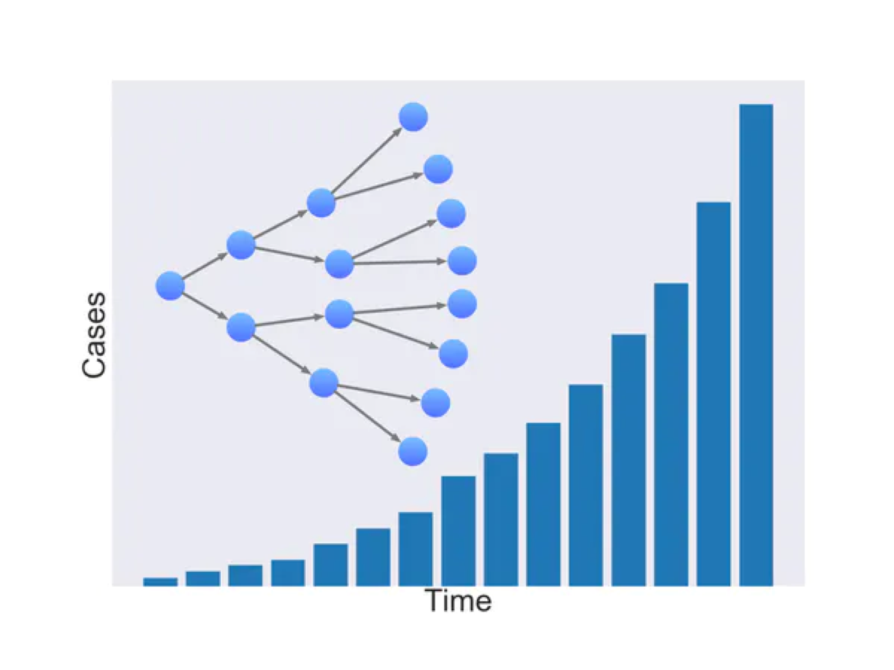
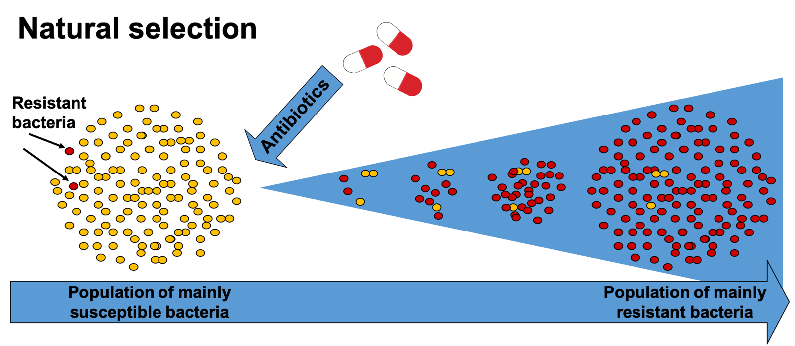
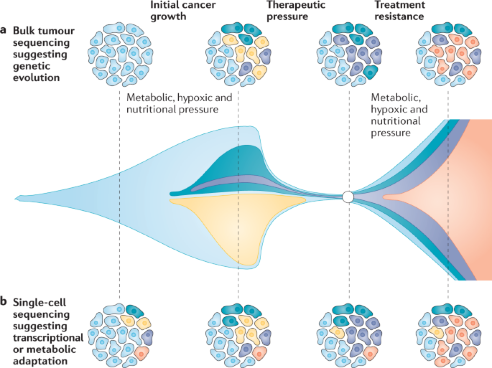
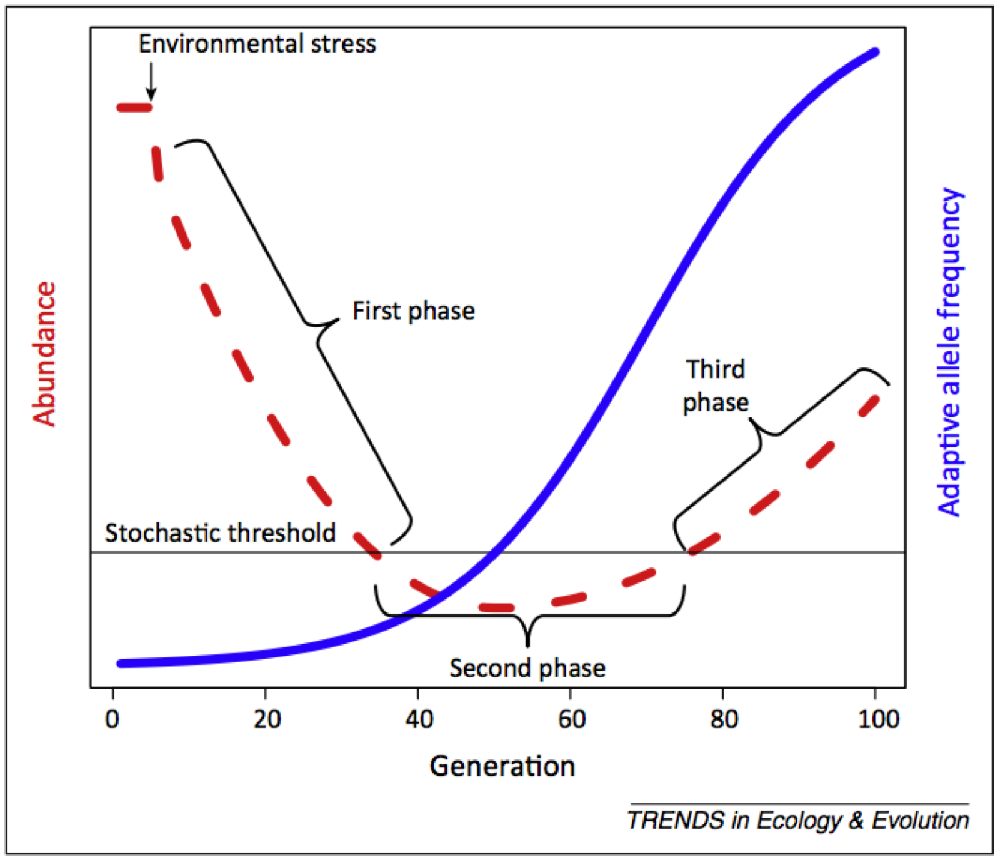

```{r}
#| label: setup
library(deSolve)
library(ggplot2)
theme_set(theme_classic(base_size = 22))
col_sim <- "#E69F00"; col_th <- "#56B4E9"; col_grey <- "grey40"
set.seed(1)
```

## This morning's SIR model says…

$R_0 > 1 \;\Rightarrow\;$ an epidemic. Always.

. . .

But:

- many imported cases never start an outbreak;
- most new mutations are lost, even beneficial ones;
- patients on antibiotics usually recover, even though resistance mutations arise all the time.

. . .

**When numbers are small, chance decides.** The ODE describes the *average*, but the average is not what happens to one rare lineage.

## Two puzzles, one question

:::: {.columns}
::: {.column width="50%"}
**Epidemic takeoff**

One infected person arrives in a fully susceptible population with $R_0 = 2$.

Will there be an epidemic?
:::
::: {.column width="50%"}
**Evolution of resistance**

A bacterial infection is treated, and the population declines. A resistant mutant appears.

Will it save the population?
:::
::::

. . .

::: {.callout-important}
## Both ask: does a **rare lineage that grows on average** escape extinction?
:::

::: notes
This is the frame for the whole lecture: first the epidemic, then resistance, then show it is the same formula.
:::

# Part 1 · Epidemic takeoff {background-color="#2C3E50"}

## Same model, simulated one event at a time

```{r}
#| label: runs
#| fig-width: 11
#| fig-height: 5.3
gillespie_sir <- function(N, beta, gamma, I0 = 1) {
  S <- N - I0; I <- I0; t <- 0
  rec <- matrix(NA_real_, 2 * N + 1, 2); k <- 1; rec[k, ] <- c(t, I)
  while (I > 0) {
    a_inf <- beta * S * I / N; a_rec <- gamma * I
    t <- t + rexp(1, a_inf + a_rec)
    if (runif(1) < a_inf / (a_inf + a_rec)) { S <- S - 1; I <- I + 1 } else I <- I - 1
    k <- k + 1; rec[k, ] <- c(t, I)
  }
  data.frame(time = rec[1:k, 1], I = rec[1:k, 2])
}
N <- 1000; R0 <- 2
runs <- do.call(rbind, lapply(1:20, function(i) cbind(gillespie_sir(N, R0, 1), run = i)))
sir_ode <- function(t, x, p) with(as.list(c(x, p)),
  list(c(-beta * S * I, beta * S * I - gamma * I, gamma * I)))
ode_out <- as.data.frame(ode(c(S = 1 - 1/N, I = 1/N, R = 0), seq(0, 25, 0.05),
                             sir_ode, c(beta = R0, gamma = 1)))
n_out <- sum(tapply(runs$I, runs$run, max) > 50)
ggplot(runs, aes(time, I, group = run)) +
  geom_step(colour = col_sim, alpha = 0.6) +
  geom_line(data = ode_out, aes(time, I * N), inherit.aes = FALSE, linewidth = 1.4) +
  labs(x = "Time", y = "Number infected",
       title = sprintf("20 runs, N = 1000, R0 = 2: %d outbreaks, %d fizzled", n_out, 20 - n_out)) +
  theme(plot.title = element_text(size = 20))
```

::: notes
Gillespie algorithm: the same two events as the ODE (infection, recovery), drawn one at a time. Code is in T2. Black line: the ODE. Ask: what fraction do you expect to fizzle?
:::

## The Gillespie algorithm {.smaller}

Same events and same rates as the ODE, but **one event at a time**, in a population of $N$ individuals:

| Event | Rate | Change |
|---|---|---|
| infection | $a_1 = \beta S I / N$ | $S - 1,\; I + 1$ |
| recovery | $a_2 = \gamma I$ | $I - 1,\; R + 1$ |

. . .

Repeat:

1. Total rate $a_0 = a_1 + a_2$.
2. Time to the next event: draw $\tau \sim \text{Exponential}(a_0)$.
3. Which event: event $i$ with probability $a_i / a_0$.
4. Update the counts and the time, and go back to 1.

## Why exponential, and why $a_i / a_0$? {.smaller}

Each event type "waits" an exponential time with its own rate: $P(\text{event } i \text{ not yet}) = e^{-a_i t}$.

. . .

**When does the first event happen?** Nothing has happened by time $t$ if *no* event has happened:

$$
P(\text{nothing by } t) = e^{-a_1 t}\, e^{-a_2 t} = e^{-a_0 t}
\quad\Rightarrow\quad \tau \sim \text{Exponential}(a_0)
$$

. . .

**Which event wins the race?**

$$
P(\text{event 1 first}) = \int_0^\infty a_1 e^{-a_1 t}\, e^{-a_2 t}\, dt = \frac{a_1}{a_1 + a_2}
$$

. . .

The method is exact: no time step, no approximation. It is the same stochastic process whose *average* the ODE describes when $N$ is large.

## Early spread is a family tree {.smaller}

:::: {.columns}
::: {.column width="55%"}

:::
::: {.column width="45%"}
Each case "gives birth" to new cases. The epidemic is a growing family tree.

- Generation sizes multiply by about $R_0$: exponential growth.
- But each branch is **random**: whole branches can end by chance.
- Early on, branches do not interfere, because susceptibles are not yet depleted.

Illustration: *The Conversation*, "How to flatten the curve of coronavirus: a mathematician explains" (2020).
:::
::::

## Branching processes {.smaller}

Early on almost everyone is susceptible, so infected individuals **do not interact**.

- Each infected individual independently causes $k$ new infections, with probability $p_k$.
- This is a *Galton–Watson branching process*: a family tree with random family sizes.

. . .

The same mathematics describes

- surnames dying out (Watson & Galton, 1875),
- beneficial mutations (Haldane, 1927),
- resistant cells in a tumour or an infection,
- transmission trees reconstructed from sequences (phylodynamics).

## Haldane's trick {.smaller}

Let $\eta$ be the probability that the lineage of **one** individual eventually dies out.

. . .

The lineage dies out if and only if **all** of its $k$ offspring lineages die out. Each does so independently, with probability $\eta$:

$$
\eta = \sum_{k=0}^{\infty} p_k\, \eta^k \;=\; G(\eta)
$$

. . .

$G$ is the *probability generating function* of the offspring distribution.

- $\eta = 1$ is always a solution.
- If the mean $G'(1) > 1$, there is a second solution $\eta < 1$, and that is the answer.

## Haldane step by step: Poisson offspring {.smaller}

Offspring number $k \sim \text{Poisson}(m)$, so $p_k = e^{-m} m^k / k!$.

. . .

$$
G(\eta) = \sum_{k=0}^\infty e^{-m}\frac{m^k}{k!}\,\eta^k
= e^{-m} \sum_{k=0}^\infty \frac{(m\eta)^k}{k!}
$$

. . .

The sum is the exponential series, $\sum_k x^k/k! = e^x$:

$$
G(\eta) = e^{-m}\, e^{m\eta} = e^{m(\eta - 1)}
$$

. . .

So the extinction probability solves

$$
\eta = e^{m(\eta - 1)}
$$

This has no closed-form solution. Solve it graphically or numerically.

## Solving $\eta = G(\eta)$ graphically

```{r}
#| label: pgf
#| fig-width: 11
#| fig-height: 5.3
eta <- seq(0, 1, length.out = 300); m <- 2
pgf <- rbind(data.frame(eta, G = exp(m * (eta - 1)), dist = "Poisson, mean 2"),
             data.frame(eta, G = 1 / (1 + m * (1 - eta)), dist = "Geometric, mean 2"))
eta_p <- uniroot(function(e) e - exp(m * (e - 1)), c(0, 1 - 1e-6))$root
fix <- data.frame(eta = c(eta_p, 1 / m), dist = c("Poisson, mean 2", "Geometric, mean 2"))
ggplot(pgf, aes(eta, G, colour = dist)) +
  geom_abline(slope = 1, intercept = 0, linetype = "dotted") +
  geom_line(linewidth = 1.5) +
  geom_point(data = fix, aes(eta, eta), size = 5) +
  scale_colour_manual(values = c(col_th, col_grey)) +
  coord_equal() +
  labs(x = expression(eta), y = expression(G(eta)), colour = NULL) +
  theme(legend.position = "right")
```

Extinction probability: where $G$ crosses the diagonal. Poisson gives $\eta \approx `r round(eta_p, 2)`$; geometric gives $\eta = 1/2$.

## Which offspring distribution does SIR have? {.smaller}

An infected person infects at rate $\beta$ and recovers at rate $\gamma$.

At every event, it is

- an **infection** with probability $q = \dfrac{\beta}{\beta + \gamma}$, or
- **recovery** (the end) with probability $1 - q$.

. . .

So the number of infections before recovery is **geometric**: $p_k = (1 - q)\,q^k$, with mean $\beta/\gamma = R_0$.

$$
G(\eta) = \frac{1}{1 + R_0(1-\eta)} \;\Rightarrow\; \eta = \frac{1}{R_0}
\qquad
\boxed{P(\text{takeoff}) = 1 - \frac{1}{R_0}}
$$

::: notes
Common mistake (also in last year's handout): assuming Poisson offspring for SIR. Poisson would be correct for a FIXED infectious period. Exponential infectious period plus Poisson infection gives a geometric distribution.
:::

## Solving $\eta = G(\eta)$ for SIR {.smaller}

Geometric offspring: $p_k = (1-q)\,q^k$ with $q = \beta/(\beta + \gamma)$.

. . .

$$
G(\eta) = (1 - q) \sum_{k=0}^\infty (q\eta)^k = \frac{1 - q}{1 - q\eta}
\qquad \text{(geometric series)}
$$

. . .

Set $\eta = G(\eta)$ and multiply out:

$$
\eta\,(1 - q\eta) = 1 - q
\quad\Rightarrow\quad
q\eta^2 - \eta + (1 - q) = 0
$$

. . .

The two roots are $\eta = 1$ and

$$
\eta = \frac{1 - q}{q} = \frac{\gamma}{\beta} = \frac{1}{R_0}
\qquad\Rightarrow\qquad
P(\text{takeoff}) = 1 - \frac{1}{R_0}
$$

With $I_0$ initial cases, each lineage must die out independently: $P(\text{takeoff}) = 1 - R_0^{-I_0}$.

## Simulation vs. theory

```{r}
#| label: takeoff
#| fig-width: 11
#| fig-height: 5.3
takeoff <- function(N, R0, threshold = 0.1 * N) {
  S <- N - 1; I <- 1
  while (I > 0 && (N - S) < threshold) {
    a_inf <- R0 * S * I / N
    if (runif(1) < a_inf / (a_inf + I)) { S <- S - 1; I <- I + 1 } else I <- I - 1
  }
  I > 0
}
R0_vec <- seq(0.5, 3, by = 0.25)
p_sim <- sapply(R0_vec, function(R0) mean(replicate(500, takeoff(1000, R0))))
p_poi <- sapply(R0_vec, function(R0) if (R0 <= 1) 0 else
  1 - uniroot(function(e) e - exp(R0 * (e - 1)), c(0, 1 - 1e-6))$root)
df <- data.frame(R0 = R0_vec, sim = p_sim, geo = pmax(0, 1 - 1 / R0_vec), poi = p_poi)
ggplot(df, aes(R0)) +
  geom_line(aes(y = geo), linewidth = 1.5, colour = col_th) +
  geom_line(aes(y = poi), linewidth = 1.2, linetype = "dashed", colour = col_grey) +
  geom_point(aes(y = sim), size = 4, colour = col_sim) +
  geom_vline(xintercept = 1, linetype = "dotted") +
  annotate("text", x = 2.3, y = 0.97, label = "Poisson offspring", colour = col_grey, size = 7) +
  annotate("text", x = 2.5, y = 0.48, label = "1 - 1/R[0]", parse = TRUE, colour = col_th, size = 8) +
  labs(x = expression(R[0]), y = "P(major outbreak)")
```

Same mean, more variance, so fewer outbreaks take off.

## Superspreading

Most people infect few others, and a few infect many: the offspring distribution is *overdispersed*.

Lloyd-Smith et al. (2005) fitted negative binomial distributions with dispersion $k$, where variance $= R_0(1 + R_0/k)$. For SARS, $k \approx 0.16$.

. . .

Consequences at the same $R_0$:

- **Fewer** introductions take off.
- The ones that do take off grow **explosively** early on.
- Targeting the few superspreaders is very effective.

::: notes
Lloyd-Smith JO, Schreiber SJ, Kopp PE, Getz WM (2005) Nature 438:355-359. Good project: replace geometric by negative binomial in the takeoff simulation.
:::

# Part 2 · Evolution of resistance {background-color="#2C3E50"}

## Treatment selects for resistance {.smaller}

:::: {.columns}
::: {.column width="50%"}


**Bacteria:** antibiotics kill sensitive cells. Rare resistant cells, already present or newly arising, take over.
:::
::: {.column width="50%"}


**Cancer:** therapy shrinks the tumour, and resistant clones regrow it. The same process at the scale of cells.
:::
::::

## Treatment resistance is evolutionary rescue {.smaller}

- Antibiotics, antivirals, chemotherapy: the pathogen or cancer population starts to **decline**.
- A resistant mutant can **rescue** it from extinction.
- This is the same process as evolutionary rescue in conservation biology (Gomulkiewicz & Holt 1995), with the opposite goal: here we *want* extinction.

. . .

**Minimal model** (discrete generations, Poisson offspring):

| | per generation | |
|---|---|---|
| sensitive cells | mean offspring $1 - r$ | decline: $N_t = N(1-r)^t$ |
| resistant cells | mean offspring $1 + s$ | growth |
| mutation | sensitive → resistant | probability $u$ per new cell |

## Most new resistant lineages are lost

```{r}
#| label: lineages
#| fig-width: 11
#| fig-height: 5.3
set.seed(7)
s <- 0.1; gens <- 80; n_lin <- 100
p_exact <- 1 - uniroot(function(e) e - exp((1 + s) * (e - 1)), c(0, 1 - 1e-6))$root
lin <- do.call(rbind, lapply(1:n_lin, function(i) {
  n <- numeric(gens + 1); n[1] <- 1
  for (g in 1:gens) n[g + 1] <- if (n[g] == 0 || n[g] > 1e4) n[g] else rpois(1, n[g] * (1 + s))
  data.frame(gen = 0:gens, n = n, run = i, survived = n[gens + 1] > 0)
}))
n_surv <- sum(tapply(lin$survived, lin$run, any))
lin <- subset(lin, n > 0)
ggplot(lin, aes(gen, n, group = run, colour = survived)) +
  geom_line(linewidth = 0.8, alpha = 0.7) +
  scale_y_log10() +
  scale_colour_manual(values = c(`TRUE` = col_sim, `FALSE` = "grey60"),
                      labels = c(`TRUE` = "established", `FALSE` = "lost")) +
  labs(x = "Generation", y = "Resistant cells (log)", colour = NULL,
       title = sprintf("%d single resistant cells, s = 0.1: %d established (Haldane: %.0f)",
                       n_lin, n_surv, n_lin * p_exact)) +
  theme(plot.title = element_text(size = 20))
```

**Drift phase** (lost or not) → **deterministic phase** (growth like $e^{st}$).

## Establishment probability of one mutant

Poisson offspring with mean $1 + s$ gives $G(\eta) = e^{(1+s)(\eta - 1)}$. Write $P = 1 - \eta$:

$$
1 - P = e^{-(1+s)P}
$$

. . .

For small $s$, $P$ is small too. Expand $e^{-x} \approx 1 - x + x^2/2$:

$$
1 - P \approx 1 - (1+s)P + \tfrac{1}{2}(1+s)^2 P^2
\;\Rightarrow\;
P \approx \frac{2s}{(1+s)^2} \approx \boxed{2s}
$$

. . .

A resistant mutant with a 5% advantage is lost about 90% of the time.

## Counting mutants

:::: {.columns}
::: {.column width="55%"}
1. Sensitive cells produced during the decline:
$\displaystyle\sum_t N(1-r)^t \approx \frac{N}{r}$

2. Resistant mutants arising: $\dfrac{Nu}{r}$

3. Each establishes with probability $2s$.

4. The number of successful mutants is roughly Poisson with mean $2Nus/r$.
:::
::: {.column width="45%"}
. . .

$$
P(\text{rescue}) \approx 1 - \exp\!\left(-\frac{2Nus}{r}\right)
$$

Orr & Unckless (2014)

The whole answer is one number: $\theta = 2Nus/r$.
:::
::::

## Simulation vs. theory

```{r}
#| label: rescue
#| fig-width: 11
#| fig-height: 5.3
rescue <- function(N, r, s, u, max_gen = 20000, threshold = 2 / s) {
  wt <- N; mut <- 0
  for (g in 1:max_gen) {
    wt <- rpois(1, wt * (1 - r)); mut <- rpois(1, mut * (1 + s))
    new <- rbinom(1, wt, u); wt <- wt - new; mut <- mut + new
    if (wt == 0 && mut == 0) return(0)
    if (mut > threshold) return(1)
  }
  NA
}
Nr <- 1e4; u <- 1e-5; sr <- 0.02
r_vec <- c(0.001, 0.002, 0.005, 0.01, 0.02, 0.05)
p_resc <- sapply(r_vec, function(r) mean(replicate(300, rescue(Nr, r, sr, u)), na.rm = TRUE))
r_fine <- 10^seq(-3, log10(0.05), length.out = 100)
ggplot() +
  geom_line(aes(r_fine, 1 - exp(-2 * Nr * u * sr / r_fine)), linewidth = 1.5, colour = col_th) +
  geom_point(aes(r_vec, p_resc), size = 4, colour = col_sim) +
  scale_x_log10() +
  labs(x = "Strength of treatment r (log scale)", y = "P(rescue by resistance)",
       title = "N = 10,000, u = 1e-5, s = 0.02") +
  theme(plot.title = element_text(size = 20))
```

## The two steps behind the formula {.smaller}

**Step 1: how many sensitive cells are ever produced?** A geometric series:

$$
\sum_{t=1}^{\infty} N (1 - r)^t = N\,\frac{1 - r}{r} \approx \frac{N}{r}
$$

Halving the killing rate doubles the number of cells, and so doubles the number of mutation opportunities.

. . .

**Step 2: why $1 - e^{-\theta}$?** There are many mutants, each rare and each independently successful with probability $2s$. The number of successes is then approximately Poisson with mean

$$
\theta = \underbrace{\frac{Nu}{r}}_{\text{mutants}} \times \underbrace{2s}_{\text{each establishes}}
$$

and rescue fails only if there are zero successes:

$$
P(\text{rescue}) = 1 - P(\text{0 successes}) = 1 - e^{-\theta}
$$

## What rescue looks like

```{r}
#| label: ucurve
#| fig-width: 11
#| fig-height: 5.2
set.seed(11)
traj <- function(N, r, s, u, max_gen = 1500) {
  wt <- N; mut <- 0; tot <- numeric(max_gen)
  for (g in 1:max_gen) {
    wt <- rpois(1, wt * (1 - r)); mut <- rpois(1, mut * (1 + s))
    new <- rbinom(1, wt, u); wt <- wt - new; mut <- mut + new
    tot[g] <- wt + mut
    if (wt + mut == 0 || mut > 5 * N) { tot <- tot[1:g]; break }
  }
  data.frame(gen = seq_along(tot), N = tot)
}
runs <- do.call(rbind, lapply(1:12, function(i) {
  d <- traj(1e4, 0.01, 0.02, 1e-5); d$run <- i; d$rescued <- tail(d$N, 1) > 0; d
}))
runs <- subset(runs, N > 0)
ggplot(runs, aes(gen, N, group = run, colour = rescued)) +
  geom_line(linewidth = 1.1) +
  scale_y_log10() +
  scale_colour_manual(values = c(`TRUE` = col_sim, `FALSE` = "grey60"),
                      labels = c(`TRUE` = "rescued", `FALSE` = "extinct")) +
  labs(x = "Generation", y = "Population size (log)", colour = NULL,
       title = sprintf("12 treated populations: N = 10,000, r = 0.01, s = 0.02 (theory: %.0f%% rescued)",
                       100 * (1 - exp(-2 * 1e4 * 1e-5 * 0.02 / 0.01)))) +
  theme(plot.title = element_text(size = 18))
```

The rescued populations make a **U-shape**: decline, a bottleneck, then recovery as the resistant lineage takes over.

## The three phases of rescue {.smaller}

:::: {.columns}
::: {.column width="55%"}

:::
::: {.column width="45%"}
Carlson, Cunningham & Westley (2014):

1. **Decline:** the old type dies out, while the adaptive allele (blue) rises from rare.
2. **Danger zone:** the population sits below a *stochastic threshold*. Chance can end it here, even if the adaptive allele has already spread.
3. **Recovery:** once adapted cells dominate, the population grows back.

Our branching-process calculation covers **phases 1–2**: does a rescue mutant arise and escape loss before the population is gone?
:::
::::

## What makes resistance more likely? {.smaller}

$$
\theta = \frac{2\,N\,u\,s}{r}
$$

| Larger $\theta$, more resistance | Clinical reading |
|---|---|
| large $N$ | treat early, while the pathogen load is small |
| high $u$ | mutagenic drugs and stress responses are bad news |
| large $s$ | resistance that is cheap and effective |
| small $r$ | slow killing: low doses, missed doses |

. . .

**Caveat:** this assumes resistant and sensitive cells do not compete. If they do, killing sensitive cells *helps* the mutant (Day 2).

## Mutants that are already there

Before treatment, resistance usually carries a **cost** $c$, and mutants sit at mutation–selection balance with frequency $\approx u/c$.

. . .

Back-of-envelope:

- pre-existing mutants $\approx Nu/c$
- new mutants during the decline $\approx Nu/r$

So **standing variation matters more than new mutations when $c < r$**: cheap resistance, fast killing.

See Orr & Unckless (2014) for the full treatment.

::: notes
Hand-waving on purpose: each pre-existing mutant establishes with roughly the same 2s once treatment starts. Good project: start the T2 simulation with mutants at mutation-selection balance.
:::

# Part 3 · One rule {background-color="#2C3E50"}

## Deriving the rule {.smaller}

Write the establishment probability as $P = 1 - \eta$ and expand $G$ around 1 (Taylor):

$$
G(1 - P) \approx 1 - G'(1)\,P + \tfrac{1}{2} G''(1)\,P^2
$$

. . .

Two facts about generating functions:

$$
G'(1) = E[k] = m, \qquad G''(1) = E[k(k-1)] = \sigma^2 + m^2 - m
$$

. . .

Insert into $1 - P = G(1 - P)$:

$$
1 - P = 1 - mP + \tfrac{1}{2}(\sigma^2 + m^2 - m)P^2
\quad\Rightarrow\quad
P = \frac{2(m - 1)}{\sigma^2 + m(m - 1)} \;\approx\; \frac{2(m-1)}{\sigma^2}
$$

The last step uses $m \approx 1$. For Poisson ($\sigma^2 = m$) the middle expression gives $2s/(1+s)^2$, as before.

## The same formula, three times {.smaller}

For a rare lineage whose mean offspring number is just above 1:

$$
\boxed{P(\text{establish}) \;\approx\; \frac{2\,(\text{mean} - 1)}{\text{variance}}}
$$

. . .

| Lineage | mean | variance | $P(\text{establish})$ |
|---|---|---|---|
| resistant mutant, Poisson | $1+s$ | $\approx 1$ | $2s$ |
| SIR infection, geometric | $R_0$ | $R_0(1+R_0) \approx 2$ | $R_0 - 1 \approx 1 - 1/R_0$ |
| superspreading, neg. binomial | $R_0$ | $\approx 1 + 1/k$ | $2(R_0 - 1)/(1 + 1/k)$ |

. . .

**Excess growth helps; variance hurts.**

## Where else this shows up

- **New variants** arising during an epidemic (Day 2)
- **Resistance within a patient**: the deterministic model always lets resistance win (Day 2)
- **Spatial structure**: a mutant arising in a refuge vs. in the treated zone (Day 3)
- **Phylodynamics**: birth–death models fitted to pathogen phylogenies to estimate $R_t$ (Stadler et al. 2013)
- **Transmissible cancer** in Tasmanian devils, from emergence to endemism (Patton et al. 2020)

## Summary

1. When numbers are small, chance decides and the ODE describes only the average.
2. Haldane: extinction probability solves $\eta = G(\eta)$.
3. SIR has geometric offspring, so $P(\text{takeoff}) = 1 - 1/R_0$.
4. A resistant mutant establishes with $P \approx 2s$, and rescue happens with $P \approx 1 - e^{-2Nus/r}$.
5. One rule: $P \approx 2(\text{mean} - 1)/\text{variance}$.

**Tutorial:** T2. All code for these figures is in it.

## Now: project menu and teams

Family **B**, branching processes and resistance, for example:

- dosing schedules: increasing, decreasing or cycling stress $r(t)$
- density-dependent advantage of resistance
- standing variation vs. new mutations
- superspreading and the takeoff probability

Plus families A (compartment), C (strain evolution), D (within-host), E (space), F (data). See the project page.

**Form teams of 3–5.** Pitch 1 is at 13:00: *one question, one model family, one figure.*

## References {.smaller .scrollable}

- Carlson SM, Cunningham CJ, Westley PAH (2014). Evolutionary rescue in a changing world. *Trends Ecol Evol* 29:521–530.
- Gomulkiewicz R, Holt RD (1995). When does evolution by natural selection prevent extinction? *Evolution* 49:201–207.
- Haldane JBS (1927). A mathematical theory of natural and artificial selection, part V: selection and mutation. *Proc Camb Philos Soc* 23:838–844.
- Lloyd-Smith JO, Schreiber SJ, Kopp PE, Getz WM (2005). Superspreading and the effect of individual variation on disease emergence. *Nature* 438:355–359.
- Orr HA, Unckless RL (2014). The population genetics of evolutionary rescue. *PLoS Genet* 10:e1004551.
- Patton AH et al. (2020). A transmissible cancer shifts from emergence to endemism in Tasmanian devils. *Science* 370:eabb9772.
- Stadler T, Kühnert D, Bonhoeffer S, Drummond AJ (2013). Birth–death skyline plot reveals temporal changes of epidemic spread in HIV and hepatitis C virus (HCV). *PNAS* 110:228–233.
- Watson HW, Galton F (1875). On the probability of the extinction of families. *J Anthropol Inst* 4:138–144.
