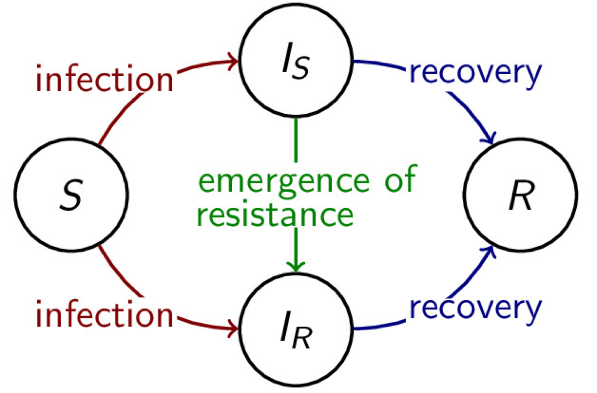
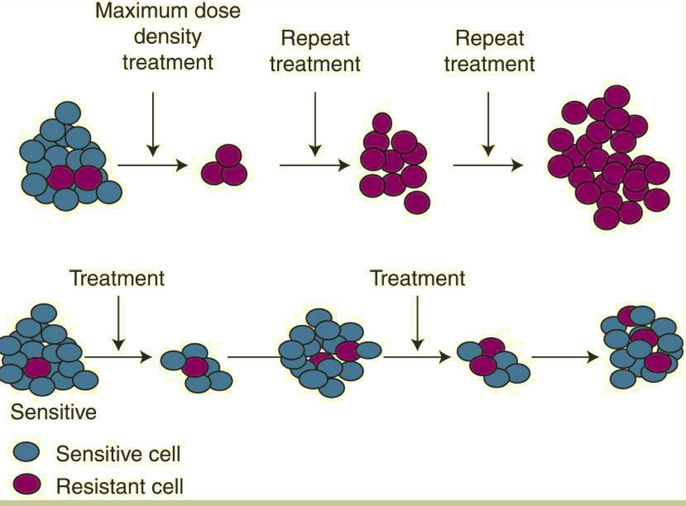
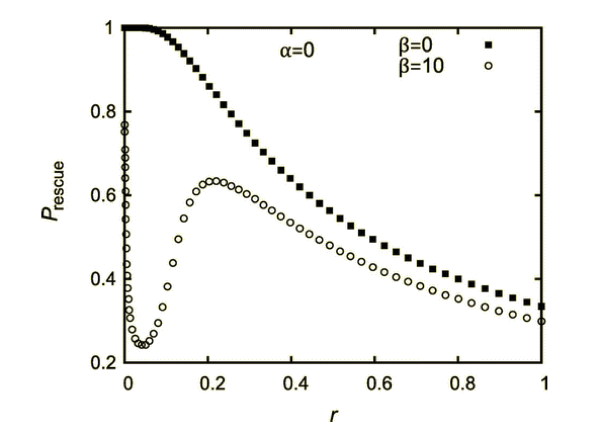
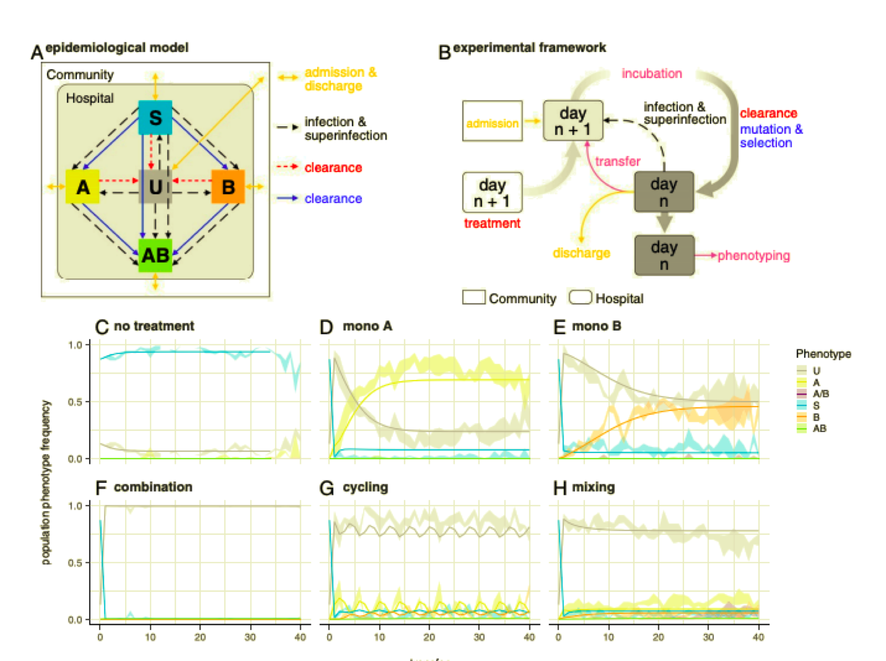

```{r}
#| label: setup
library(deSolve)
library(ggplot2)
library(tidyr)
theme_set(theme_classic(base_size = 22))
col_res <- "#999999"; col_mut <- "#E69F00"; col_wt <- "#56B4E9"; col_rm <- "#D55E00"
```

## Where we are

:::: {.columns}
::: {.column width="50%"}
**Day 1**

- SIR: how an epidemic unfolds
- Branching processes: does a rare lineage take off?
- Takeoff $\approx 1 - 1/R_0$; rescue $\approx 1 - e^{-2Nus/r}$
:::
::: {.column width="50%"}
**Today: the pathogen evolves**

- *Between hosts:* which strain wins?
- *Within a host:* when does treatment select for resistance?
:::
::::

. . .

**One message:** in both cases the winner is the strain with the larger reproduction number, and *whether* it gets the chance to win is a Day 1 question.

::: notes
Frame the lecture: same competition logic at two scales. Pitch 2 follows right after this lecture, so remind them to note down which parts are relevant for their project.
:::

# Part 1 · Between hosts {background-color="#2C3E50"}

## The question

A mutant strain appears in a population where a resident strain is endemic.

- Recovery from either strain protects against both (complete cross-immunity).
- The two strains compete for the **same susceptible hosts**.

**When does the mutant take over?**

. . .

Examples: SARS-CoV-2 variants replacing each other; seasonal influenza lineages; myxoma virus in Australian rabbits.

## Two strains, one pool of susceptibles

$$
\begin{aligned}
\frac{dS}{dt}   &= \mu - (\beta_1 I_1 + \beta_2 I_2) S - \mu S \\[4pt]
\frac{dI_i}{dt} &= \beta_i S I_i - (\gamma_i + \mu) I_i \qquad i = 1, 2 \\[4pt]
\frac{dR}{dt}   &= \gamma_1 I_1 + \gamma_2 I_2 - \mu R
\end{aligned}
$$

. . .

Each strain alone: $R_0^{(i)} = \dfrac{\beta_i}{\gamma_i + \mu}$, with endemic equilibrium $S^* = 1/R_0^{(i)}$.

::: notes
This is the SIR with demography from Lecture 1, just with two I compartments. Ask: why do we need births for this question? (Without births there is no endemic resident to invade.)
:::

## Invasion analysis

While the mutant is rare, the resident sits at its equilibrium, $S^* = 1/R_0^{(1)}$.

The mutant's per-capita growth rate is then

$$
\lambda = \beta_2 S^* - (\gamma_2 + \mu)
\;=\; (\gamma_2 + \mu)\left(\frac{R_0^{(2)}}{R_0^{(1)}} - 1\right).
$$

. . .

::: {.callout-important}
## The mutant invades if and only if $R_0^{(2)} > R_0^{(1)}$.
:::

It does not have to transmit faster. It only needs more secondary infections over its whole infectious period.

::: notes
Derive on the board: substitute S* = (gamma1+mu)/beta1. This is the "invasion fitness" idea from adaptive dynamics: grow the rare type in the environment set by the resident.
:::

## Where $S^*$ comes from {.smaller}

Strain 1 alone, at its endemic equilibrium. Set $dI_1/dt = 0$ with $I_1 > 0$:

$$
\beta_1 S^* I_1 - (\gamma_1 + \mu) I_1 = 0
\quad\Rightarrow\quad
S^* = \frac{\gamma_1 + \mu}{\beta_1} = \frac{1}{R_0^{(1)}}
$$

. . .

Now add one rare mutant. It barely changes $S$, so its growth rate is

$$
\frac{1}{I_2}\frac{dI_2}{dt} = \beta_2 S^* - (\gamma_2 + \mu)
= (\gamma_2 + \mu)\left(\frac{\beta_2}{\gamma_2 + \mu}\cdot\frac{1}{R_0^{(1)}} - 1\right)
$$

. . .

and $\beta_2/(\gamma_2 + \mu) = R_0^{(2)}$, which gives $\lambda = (\gamma_2+\mu)\left(R_0^{(2)}/R_0^{(1)} - 1\right)$.

**Invasion fitness:** let the resident set the environment (here $S^*$), then ask whether the rare type grows in it.

## Why only one strain survives {.smaller}

Each strain alone would push susceptibles down to its own level:

$$
S^*_1 = 1/R_0^{(1)}, \qquad S^*_2 = 1/R_0^{(2)}
$$

. . .

- Strain $i$ grows only if $S > S^*_i$.
- The strain with the larger $R_0$ pushes $S$ *below* the level the other strain needs.
- So the other strain declines. Both can only coexist if $S^*_1 = S^*_2$ exactly.

. . .

This is **competitive exclusion**, the same logic as resource competition in ecology. The strain that tolerates the lowest resource level wins. Here the resource is susceptible hosts.

Coexistence needs something more: partial cross-immunity, different host groups, or space. That is good project material.

## Lower transmission, but it still wins

```{r}
#| label: replacement
#| fig-width: 11
#| fig-height: 5.2
two_strain <- function(t, x, p) with(as.list(c(x, p)), {
  dS  <- mu - (b1 * I1 + b2 * I2) * S - mu * S
  dI1 <- b1 * S * I1 - (g1 + mu) * I1
  dI2 <- b2 * S * I2 - (g2 + mu) * I2
  dR  <- g1 * I1 + g2 * I2 - mu * R
  list(c(dS, dI1, dI2, dR))
})
p   <- c(b1 = 3, g1 = 1, b2 = 2.4, g2 = 0.7, mu = 0.01)
R01 <- with(as.list(p), b1 / (g1 + mu)); R02 <- with(as.list(p), b2 / (g2 + mu))
S0  <- 1 / R01; I10 <- with(as.list(p), mu * (R01 - 1) / b1)
out <- as.data.frame(ode(c(S = S0, I1 = I10, I2 = 1e-6, R = 1 - S0 - I10 - 1e-6),
                         seq(0, 300, 0.5), two_strain, p))
long <- pivot_longer(out[, c("time", "I1", "I2")], -time, names_to = "strain", values_to = "I")
ggplot(long, aes(time, I, colour = strain)) +
  geom_line(linewidth = 1.5) +
  scale_y_log10() + coord_cartesian(ylim = c(1e-8, NA)) +
  scale_colour_manual(values = c(I1 = col_res, I2 = col_mut),
                      labels = c(sprintf("resident  β = 3.0, 1/γ = 1.0, R0 = %.2f", R01),
                                 sprintf("mutant    β = 2.4, 1/γ = 1.4, R0 = %.2f", R02))) +
  labs(x = "Time", y = "Proportion infected (log)", colour = NULL) +
  theme(legend.position = "top", legend.direction = "vertical")
```

::: notes
Initial slope of the mutant matches lambda = 0.098 exactly (checked in T3). Competitive exclusion: with one shared resource (S) only one strain persists.
:::

## Quick check

Strain 2 transmits **twice as fast** as strain 1, but infected hosts recover **three times faster**.

Same $\mu$, with $\mu \ll \gamma$.

**Who wins?**

. . .

$$
\frac{R_0^{(2)}}{R_0^{(1)}} \approx \frac{2\beta_1 / 3\gamma_1}{\beta_1/\gamma_1} = \frac{2}{3} < 1
\quad\Rightarrow\quad \text{the resident wins.}
$$

## So why don't pathogens maximise $R_0$ without limit? {.smaller}

Pathogens that replicate faster

- transmit better: $\beta$ goes up, **but**
- harm or kill their host sooner: virulence $\alpha$ goes up, which shortens the infectious period.

$$
R_0(\alpha) = \frac{\beta(\alpha)}{\gamma + \mu + \alpha}
$$

. . .

This is the **transmission–virulence trade-off** (Anderson & May 1982; Alizon et al. 2009).

## A simple trade-off gives intermediate virulence

:::: {.columns}
::: {.column width="45%"}
Take $\beta(\alpha) = b\sqrt{\alpha}$:

$$
\frac{dR_0}{d\alpha} = 0
\;\Rightarrow\;
\alpha^* = \gamma + \mu
$$

Optimal virulence equals the rate at which hosts clear the infection or die of other causes.

Since the largest $R_0$ wins, evolution should drive $\alpha \to \alpha^*$.
:::
::: {.column width="55%"}
```{r}
#| label: tradeoff
#| fig-width: 6.5
#| fig-height: 5
b <- 3; g <- 1; mu <- 0.01
alpha <- seq(0.01, 6, length.out = 300)
ggplot(data.frame(alpha, R0 = b * sqrt(alpha) / (g + mu + alpha)), aes(alpha, R0)) +
  geom_line(linewidth = 1.5, colour = col_mut) +
  geom_vline(xintercept = g + mu, linetype = "dashed") +
  annotate("text", x = g + mu + 0.15, y = 0.4, label = "alpha^'*' == gamma + mu",
           parse = TRUE, hjust = 0, size = 7) +
  labs(x = expression("Virulence " * alpha), y = expression(R[0]))
```
:::
::::

## Finding $\alpha^*$ {.smaller}

Write $c = \gamma + \mu$, so $R_0(\alpha) = b\,\sqrt{\alpha}\,/\,(c + \alpha)$. Use the quotient rule:

. . .

$$
\frac{dR_0}{d\alpha}
= b\,\frac{\frac{1}{2\sqrt{\alpha}}\,(c + \alpha) - \sqrt{\alpha}}{(c + \alpha)^2}
$$

. . .

This is zero when the numerator is zero. Multiply by $2\sqrt{\alpha}$:

$$
(c + \alpha) - 2\alpha = 0
\quad\Rightarrow\quad
\alpha^* = c = \gamma + \mu
$$

. . .

**Interpretation:** at the optimum, the pathogen kills its host at the same rate as the host clears the infection or dies of other causes. A different trade-off shape gives a different $\alpha^*$, which is why measuring the trade-off matters.

## Evidence, and caveats {.smaller}

**Myxoma virus in Australia** (released 1950)

- The original strain killed more than 99% of infected rabbits.
- Within a few years, strains of *intermediate* virulence dominated (Fenner & Ratcliffe 1965; Kerr et al. 2012).

. . .

**Caveats**

- The shape of the trade-off is hard to measure, and often assumed rather than shown (Alizon et al. 2009).
- Hosts evolve too: myxoma virulence later *increased* again as rabbits became resistant (Kerr et al. 2017).
- With spatial structure or superinfection, the "maximise $R_0$" rule can fail.

::: notes
Good project material: any of these caveats is a project. Point to the project menu, family C.
:::

## A variant arising during *one* epidemic

There is no endemic equilibrium now. Mutants arise at rate $u \times$ (new infections) and must survive the branching phase from Day 1:

$$
P(\text{variant establishes}) \approx 1 - \exp\!\left(-\int u N \beta S I \;\max\!\Big[0,\; 1 - \tfrac{1}{R_0^{(m)} S(t)}\Big]\, dt\right)
$$

. . .

- The establishment term needs $R_0^{(m)} S(t) > 1$, so a variant must arise **early**, before $S$ has dropped.
- Many infections help (more chances), but they also use up $S$.

::: notes
This is T3 Part C. It is an approximation (S keeps falling while the lineage is small); checking it with Gillespie is a good project.
:::

## Bridge: resistance spreading between hosts {.smaller}

:::: {.columns}
::: {.column width="50%"}

:::
::: {.column width="50%"}
Part 1's two-strain model, with treatment:

- **$I_S$:** infected with a drug-sensitive strain. Treated, so they recover fast.
- **$I_R$:** infected with a resistant strain, which treatment does not help.
- **Emergence:** resistance arises *within* treated hosts, $I_S \to I_R$.

Treatment lowers $R_0$ of the sensitive strain, so by Part 1 it **hands the advantage to the resistant strain**.
:::
::::

. . .

But where does the $I_S \to I_R$ arrow come from? From evolution **inside one patient**. That is Part 2.

# Part 2 · Within a host {background-color="#2C3E50"}

## The same structure, one level down

| Between hosts | Within a host |
|---|---|
| susceptible people $S$ | uninfected target cells $T$ |
| infected people $I$ | infected cells $I$ |
| contacts | free virus $V$ |
| recovery $\gamma$ | infected-cell death $\delta$ |
| births $\mu$ | cell production $\lambda$ |
| treatment of people | antiviral drugs |

## The target-cell model

$$
\frac{dT}{dt} = \lambda - dT - \beta T V, \qquad
\frac{dI}{dt} = \beta T V - \delta I, \qquad
\frac{dV}{dt} = p I - c V
$$

. . .

Within-host basic reproduction number:

$$
R_0 = \underbrace{\frac{\lambda}{d}}_{\text{target cells}}\;\cdot\;
\underbrace{\beta}_{\text{infection}}\;\cdot\;
\underbrace{\frac{p}{\delta}}_{\text{virions per cell}}\;\cdot\;
\underbrace{\frac{1}{c}}_{\text{virion lifetime}}
$$

The chronic infection settles at $T^* = T_0/R_0$, just as $S^* = 1/R_0$ in SIR.

::: notes
Perelson 2002 Nat Rev Immunol; Nowak & May 2000 "Virus Dynamics". Read R0 as a chain: one infected cell makes p/delta virions, each lives 1/c and infects at rate beta*T0.
:::

## Within-host $R_0$, step by step {.smaller}

Follow **one infected cell** in a fresh host, with $T = T_0 = \lambda/d$ target cells:

. . .

1. It lives on average $1/\delta$ days and produces $p$ virions per day: **$p/\delta$ virions**.
2. Each virion lives $1/c$ days and infects at rate $\beta T_0$: **$\beta T_0 / c$ infected cells per virion**.

. . .

Multiply:

$$
R_0 = \frac{p}{\delta} \cdot \frac{\beta T_0}{c} = \frac{\beta\,\lambda\,p}{d\,\delta\,c}
$$

. . .

With HIV-like values ($\beta = 2\times10^{-7}$, $\lambda = 10^4$, $p = 1000$, $d = 0.01$, $\delta = 1$, $c = 23$):

$$
R_0 = \frac{2\times10^{-7}\cdot 10^4 \cdot 1000}{0.01 \cdot 1 \cdot 23} \approx 8.7
$$

## The chronic infection {.smaller}

At equilibrium, $dV/dt = 0$ gives $V^* = p I^*/c$. Insert this into $dI/dt = 0$:

$$
\beta T^* \frac{p I^*}{c} = \delta I^*
\quad\Rightarrow\quad
T^* = \frac{\delta c}{\beta p} = \frac{T_0}{R_0}
$$

. . .

- This is the same as $S^* = 1/R_0$ in SIR: the virus depletes target cells until each infected cell just replaces itself.
- With $R_0 \approx 8.7$, only about 11% of target cells remain in chronic infection.

. . .

**Keep this in mind:** when treatment starts, target cells are *depleted*. That will matter in a few slides.

## Drug and resistance

- The drug blocks infection: $\beta \to (1 - \varepsilon)\beta$, with $\varepsilon(D) = \dfrac{D}{D + \mathrm{IC}_{50}}$.
- The resistant mutant
  - pays a fitness **cost** $\kappa$: $\beta_M = (1 - \kappa)\beta$,
  - needs a **$\rho$-fold** higher dose: $\varepsilon_M(D) = \dfrac{D}{D + \rho\,\mathrm{IC}_{50}}$,
  - arises with probability $u$ per infection.

. . .

Before treatment, mutants are already present at **mutation–selection balance**. That is standing variation, as in the Day 1 exercise.

```{r}
#| label: wh-model
wh <- function(t, x, p) with(as.list(c(x, p)), {
  eW <- D / (D + IC50); eM <- D / (D + rho * IC50)
  infW <- (1 - eW) * beta * T * VW
  infM <- (1 - eM) * (1 - kappa) * beta * T * VM
  list(c(lambda - d * T - infW - infM,
         (1 - u) * infW - delta * IW,
         u * infW + infM - delta * IM,
         p * IW - c * VW,
         p * IM - c * VM))
})
pars <- c(lambda = 1e4, d = 0.01, beta = 2e-7, delta = 1, p = 1000, c = 23,
          kappa = 0.2, rho = 10, u = 3e-5, IC50 = 1, D = 0)
R0  <- with(as.list(pars), beta * lambda * p / (d * delta * c))
R0M <- (1 - pars[["kappa"]]) * R0
pre <- ode(c(T = 1e6, IW = 0, IM = 0, VW = 1e-3, VM = 0), seq(0, 1000, 1), wh, pars)
eq  <- pre[nrow(pre), -1]
IC50 <- 1; rho <- pars[["rho"]]; kappa <- pars[["kappa"]]
Dx <- rho * kappa / (rho * (1 - kappa) - 1) * IC50
DW <- (R0 - 1) * IC50
DM <- rho * (R0M - 1) * IC50
treat <- function(D, days = 365) as.data.frame(ode(eq, seq(0, days, 0.5), wh, replace(pars, "D", D)))
```

## How many mutants before treatment? {.smaller}

At the chronic equilibrium, the wild type exactly replaces itself. The mutant, with cost $\kappa$, replaces only a fraction $1 - \kappa$ of itself, and is resupplied by mutation:

$$
\frac{dI_M}{dt} = \underbrace{u\,\delta I_W}_{\text{new mutants}} + \underbrace{(1-\kappa)\,\delta I_M}_{\text{own replication}} - \underbrace{\delta I_M}_{\text{death}} = 0
$$

. . .

$$
\boxed{\frac{I_M}{I_W} = \frac{u}{\kappa}}
\qquad \text{mutation–selection balance}
$$

. . .

Here: $u/\kappa = 3\times10^{-5}/0.2 = 1.5\times10^{-4}$. In the simulation, `r signif(eq[["IM"]] / eq[["IW"]], 2)`.

With about $10^4$ infected cells per mL, that is roughly one resistant infected cell per mL **before treatment even starts**.

## Three doses that matter {.smaller}

Effective reproduction numbers under treatment:

$$
R_W(D) = \frac{R_0\,\mathrm{IC}_{50}}{D + \mathrm{IC}_{50}}, \qquad
R_M(D) = \frac{(1-\kappa)R_0\,\rho\,\mathrm{IC}_{50}}{D + \rho\,\mathrm{IC}_{50}}
$$

. . .

| Threshold | Meaning | Formula | Here |
|---|---|---|---|
| $D_x$ | resistance favoured ($R_M > R_W$) | $\rho\kappa / (\rho(1-\kappa)-1)\cdot\mathrm{IC}_{50}$ | `r round(Dx, 2)` |
| $D_W$ | wild type cannot persist | $(R_0 - 1)\,\mathrm{IC}_{50}$ | `r round(DW, 1)` |
| $D_M$ | nothing persists | $\rho\big((1-\kappa)R_0 - 1\big)\,\mathrm{IC}_{50}$ | `r round(DM, 1)` |

Illustrative HIV-like parameters: $R_0 =$ `r round(R0, 1)`, $\kappa = 0.2$, $\rho = 10$.

## Deriving the thresholds {.smaller}

**$D_W$, the wild type cannot persist:** set $R_W(D) = 1$:

$$
\frac{R_0\,\mathrm{IC}_{50}}{D + \mathrm{IC}_{50}} = 1
\;\Rightarrow\; D + \mathrm{IC}_{50} = R_0\,\mathrm{IC}_{50}
\;\Rightarrow\; D_W = (R_0 - 1)\,\mathrm{IC}_{50}
$$

$D_M$ is the same calculation with $(1-\kappa)R_0$ and $\rho\,\mathrm{IC}_{50}$.

. . .

**$D_x$, resistance is favoured:** set $R_W(D) = R_M(D)$ and cancel $R_0$ (write $\mathrm{IC}_{50} = 1$):

$$
\frac{1}{D + 1} = \frac{(1-\kappa)\rho}{D + \rho}
\;\Rightarrow\; D + \rho = (1-\kappa)\rho\,(D + 1)
\;\Rightarrow\; D_x = \frac{\rho\kappa}{\rho(1-\kappa) - 1}
$$

. . .

- $D_x$ is small when the cost $\kappa$ is small: **cheap resistance is favoured by almost any dose**.
- $D_x$ exists only if $\rho(1-\kappa) > 1$, i.e. resistance must outweigh its cost.

## The selection window is only part of the story

```{r}
#| label: reff
#| fig-width: 11
#| fig-height: 5.4
doses <- 10^seq(-1, 3, length.out = 200)
reff  <- rbind(data.frame(dose = doses, R = R0 * IC50 / (doses + IC50), virus = "wild type"),
               data.frame(dose = doses, R = R0M * rho * IC50 / (doses + rho * IC50), virus = "resistant"))
ggplot(reff, aes(dose, R, colour = virus)) +
  annotate("rect", xmin = DW, xmax = DM, ymin = 0, ymax = Inf, alpha = 0.15) +
  annotate("text", x = sqrt(DW * DM), y = 0.02, label = "classical\nselection window", size = 6) +
  geom_line(linewidth = 1.5) +
  geom_hline(yintercept = 1, linetype = "dotted") +
  geom_vline(xintercept = Dx, linetype = "dashed") +
  annotate("text", x = Dx * 1.15, y = 0.02, label = "D[x]", parse = TRUE, hjust = 0, size = 7) +
  scale_x_log10() + scale_y_log10() +
  scale_colour_manual(values = c(`wild type` = col_wt, resistant = col_rm)) +
  labs(x = expression("Dose (multiples of " * IC[50] * ")"), y = "Effective R (log)", colour = NULL)
```

::: notes
Classical MSW (Drlica): between the MIC of the wild type and the MIC of the mutant. But in competition, the mutant already wins above D_x, because it has the larger R (same logic as Part 1). Below D_W the wild type would persist alone, but it is outcompeted.
:::

## Treatment inside the window: 20 × IC~50~

```{r}
#| label: timecourse
#| fig-width: 11
#| fig-height: 5.2
tc <- treat(20)
long <- pivot_longer(tc[, c("time", "VW", "VM")], -time, names_to = "virus", values_to = "V")
ggplot(long, aes(time, pmax(V, 1e-3), colour = virus)) +
  geom_line(linewidth = 1.5) +
  scale_y_log10() +
  scale_colour_manual(values = c(VW = col_wt, VM = col_rm),
                      labels = c(VM = "resistant", VW = "wild type")) +
  labs(x = "Days of treatment", y = "Virus per mL (log)", colour = NULL)
```

Both strains crash first, because target cells are depleted. The resistant strain then rebounds as target cells recover.

## Why both strains crash first {.smaller}

At the start of treatment, target cells are at $T^* = T_0/R_0$, not $T_0$. The effective reproduction number of the mutant is therefore

$$
R_M(D)\cdot\frac{T^*}{T_0} = \frac{R_M(D)}{R_0}
$$

. . .

At $D = 20\,\mathrm{IC}_{50}$: $R_M = `r round(R0M * rho / (20 + rho), 2)`$, so $R_M / R_0 = `r round(R0M * rho / (20 + rho) / R0, 2)` < 1$, and **the mutant declines too**.

. . .

- Target cells recover at rate $d = 0.01$/day, a time scale of months.
- Once $T/T_0 > 1/R_M(D)$, the mutant grows again.
- The deterministic model lets it regrow from a tiny fraction of a virion. A real patient may have lost every resistant virus during the dip.

**In this model,** the first weeks of treatment are when resistance is most vulnerable. Whether that holds for real patients is a question for a stochastic model (project!).

## Outcome after one year, by dose

```{r}
#| label: dose-scan
#| fig-width: 11
#| fig-height: 5.4
scan <- do.call(rbind, lapply(10^seq(-1, 3, length.out = 61), function(D) {
  last <- tail(treat(D), 1)
  data.frame(dose = D, virus = c("wild type", "resistant"), V = c(last$VW, last$VM))
}))
ggplot(scan, aes(dose, pmax(V, 1e-3), colour = virus)) +
  annotate("rect", xmin = DW, xmax = DM, ymin = 0, ymax = Inf, alpha = 0.15) +
  geom_line(linewidth = 1.5) +
  geom_vline(xintercept = Dx, linetype = "dashed") +
  scale_x_log10() + scale_y_log10() +
  scale_colour_manual(values = c(`wild type` = col_wt, resistant = col_rm)) +
  labs(x = expression("Dose (multiples of " * IC[50] * ")"),
       y = "Virus per mL after 1 year (log)", colour = NULL)
```

## Where the deterministic model lies

At its lowest point, the resistant virus in the ODE is at **`r format(signif(min(tc$VM), 2), scientific = TRUE)` virions per mL**, and then it rebounds.

. . .

A real patient cannot carry a fraction of a virion.

- In the ODE, resistance is never truly zero, so whenever it is favoured it always wins.
- In reality a resistant mutant must **arise** and **escape stochastic loss** before the wild type is gone.

. . .

That is evolutionary rescue from Day 1:

$$
P(\text{resistance}) \approx 1 - \exp\big(-\text{(mutants produced)} \times P(\text{establish})\big)
$$

## What this means for treatment

- **Combination therapy** (e.g. HIV): resistance needs several mutations, so the "mutants produced" term collapses.
- **Adherence:** missed doses move the drug concentration *through* the window, again and again.
- **Hit hard, or contain?** Aggressive treatment removes competitors of resistant cells. Whether it helps or hurts is an open debate (Read, Day & Huijben 2011, *PNAS*).

::: notes
Read et al. 2011 "The evolution of drug resistance and the curious orthodoxy of aggressive chemotherapy". Link back to the Uecker/Otto/Hermisson point from the ER deck: competition release.
:::

## Hit hard, or contain? {.smaller}

{fig-align="center" height="360"}

**Top:** maximum dose removes the sensitive cells, and with them the competitors of the resistant cells. **Bottom:** treat only enough to keep the tumour or infection in check, and sensitive cells keep resistant cells suppressed. This is the idea behind *adaptive therapy* in cancer.

## Competition changes the answer {.smaller}

:::: {.columns}
::: {.column width="55%"}

:::
::: {.column width="45%"}
Rescue probability against treatment strength $r$ (Uecker, Otto & Hermisson 2014):

- **No competition** (squares): stronger treatment always lowers the chance of resistance, as on Day 1.
- **Sensitive and resistant cells compete** (circles): the curve is no longer monotonic. Over a range of $r$, **stronger treatment makes resistance more likely**, because it frees resources for the resistant cells.
:::
::::

## Treatment strategies in a hospital {.smaller}

{fig-align="center" height="370"}

Angst et al. (2021) ran an *in vitro* hospital: wells of bacteria are "patients", admitted, treated and discharged each day. They compared no treatment, monotherapy, combination therapy, cycling and mixing. In their setup combination therapy (F) kept resistance lowest.

## Summary

1. **Between hosts:** the strain with the larger $R_0$ invades and wins. With a transmission–virulence trade-off that means *intermediate* virulence, $\alpha^* = \gamma + \mu$.
2. **Within a host:** the same competition, now for target cells. Resistance is favoured above $D_x$, and only doses above $D_M$ stop everything.
3. **In both:** *whether* the better strain appears is a branching-process question, and deterministic models get it wrong.

**Tutorials:** T3 (strain invasion), T4 (within-host)

## Pitch 2 — The model (3 min per team)

1. **Model diagram:** boxes and arrows, or a list of events with their rates
2. **Parameters:** values and sources, or toy values that you say are toy values
3. **Reference case:** what you compare against
4. **Prediction:** what you expect *before* running anything

. . .

**Project hooks from today:** a ladder of virulence strains · partial cross-immunity and coexistence · emergence checked with Gillespie · missed doses and pharmacokinetics · combination therapy · stochastic resistance within a host

## References {.smaller .scrollable}

- Alizon S, Hurford A, Mideo N, Van Baalen M (2009). Virulence evolution and the trade-off hypothesis. *J Evol Biol* 22:245–259.
- Angst DC, Tepekule B, Sun L, Bogos B, Bonhoeffer S (2021). Comparing treatment strategies to reduce antibiotic resistance in an in vitro epidemiological setting. *PNAS* 118:e2023467118.
- Uecker H, Otto SP, Hermisson J (2014). Evolutionary rescue in structured populations. *Am Nat* 183:E17–E35.
- Anderson RM, May RM (1982). Coevolution of hosts and parasites. *Parasitology* 85:411–426.
- Fenner F, Ratcliffe FN (1965). *Myxomatosis*. Cambridge University Press.
- Kerr PJ et al. (2012). Evolutionary history and attenuation of myxoma virus on two continents. *PLoS Pathog* 8:e1002950.
- Kerr PJ et al. (2017). Next step in the ongoing arms race between myxoma virus and wild rabbits in Australia is a novel disease phenotype. *PNAS* 114:9397–9402.
- Nowak MA, May RM (2000). *Virus Dynamics*. Oxford University Press.
- Perelson AS (2002). Modelling viral and immune system dynamics. *Nat Rev Immunol* 2:28–36.
- Read AF, Day T, Huijben S (2011). The evolution of drug resistance and the curious orthodoxy of aggressive chemotherapy. *PNAS* 108:10871–10877.
