```{r}
#| label: setup
library(ggplot2)
library(EpiEstim)
library(dplyr)
theme_set(theme_classic(base_size = 22))
col_loc <- "#E69F00"; col_mix <- "grey40"; col_a <- "#56B4E9"; col_b <- "#D55E00"
set.seed(3)
```

## Two assumptions we have made all along

:::: {.columns}
::: {.column width="50%"}
**Mass action**

Every infected person can infect every susceptible person.

*Today, part 1:* what happens when contacts are **local**?
:::
::: {.column width="50%"}
**Known parameters**

We picked $\beta$, $\gamma$ and $R_0$.

*Today, part 2:* how do we get them from **data**, and how far can we trust them?
:::
::::

. . .

After the lecture: **Pitch 3, first result.** One figure per team.

# Part 1 · Space and individuals {background-color="#2C3E50"}

## An epidemic on a grid

Each cell is one individual: susceptible, infected or recovered. In every time step:

- a susceptible cell with $k$ infected neighbours (up, down, left, right) is infected with probability $1 - (1-p)^k$;
- an infected cell recovers with probability $q$.

. . .

This is an **individual-based model**: no compartments and no ODEs, just rules for each individual.

For comparison, the **well-mixed** version: the same $p$, $q$ and 4 contacts, but the contacts are drawn from the whole population.

```{r}
#| label: ca
shift <- function(m, dr, dc) {
  L <- nrow(m); out <- matrix(0, L, L)
  rs <- max(1, 1 + dr):min(L, L + dr); cs <- max(1, 1 + dc):min(L, L + dc)
  out[rs, cs] <- m[rs - dr, cs - dc]; out
}
step_ca <- function(grid, p, q, mixed) {
  inf <- (grid == 1) * 1
  k <- if (mixed) 4 * mean(inf) else
    shift(inf, 1, 0) + shift(inf, -1, 0) + shift(inf, 0, 1) + shift(inf, 0, -1)
  ni <- grid == 0 & runif(length(grid)) < 1 - (1 - p)^k
  rc <- grid == 1 & runif(length(grid)) < q
  grid[ni] <- 1L; grid[rc] <- 2L
  grid
}
seed_grid <- function(L) {
  g <- matrix(0L, L, L); c0 <- ceiling(L / 2)
  g[c0 + (-1:1), c0] <- 1L; g[c0, c0 + c(-1, 1)] <- 1L
  g
}
```

## From rules to numbers {.smaller}

**How long does a cell stay infected?** It recovers with probability $q$ per step, so the number of infectious steps is geometric, with mean $1/q$.

. . .

**Well mixed:** per step, one infected cell infects about $4p$ others (small $p$). Over $1/q$ steps:

$$
R_0 \approx \frac{4p}{q}
\qquad\Rightarrow\qquad \text{threshold at } p = q/4
$$

. . .

**On the grid:** what matters is the chance $T$ that a given neighbour is ever infected. The neighbour escapes each step with probability $1-p$, and the cell transmits for $n$ steps with $P(n) = q(1-q)^{n-1}$:

$$
T = 1 - \sum_{n \ge 1} q(1-q)^{n-1}(1-p)^n = 1 - \frac{q(1-p)}{1 - (1-q)(1-p)}
$$

We need $T$ for the threshold in a few slides.

## Watch it spread {.smaller}

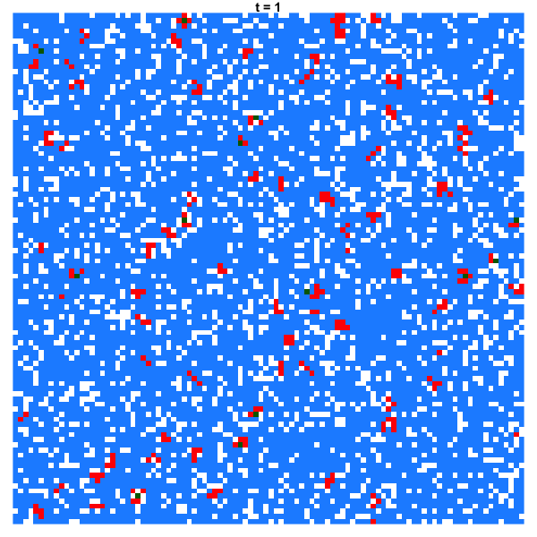{fig-align="center" height="430"}

## The epidemic spreads as a wave

```{r}
#| label: snapshots
#| fig-width: 12
#| fig-height: 4.6
L <- 101; g <- seed_grid(L); snaps <- list(); cum_local <- numeric(150)
for (t in 1:150) {
  g <- step_ca(g, 0.3, 0.2, FALSE); cum_local[t] <- sum(g > 0)
  if (t %in% c(20, 50, 80)) snaps[[as.character(t)]] <- g
}
snap_df <- do.call(rbind, lapply(names(snaps), function(t) {
  m <- snaps[[t]]
  data.frame(x = rep(1:L, each = L), y = rep(1:L, L),
             state = factor(c(m), levels = 0:2, labels = c("S", "I", "R")),
             time = factor(paste("t =", t), levels = paste("t =", names(snaps))))
}))
ggplot(snap_df, aes(x, y, fill = state)) +
  geom_raster() + facet_wrap(~time) + coord_equal() +
  scale_fill_manual(values = c(S = "grey92", I = col_loc, R = col_a)) +
  theme_void(base_size = 22) + labs(fill = NULL)
```

Infections can only happen at the **front**. Behind it, everyone has already recovered.

## Local contacts kill exponential growth

```{r}
#| label: growth
#| fig-width: 11
#| fig-height: 5
g <- seed_grid(L); cum_mixed <- numeric(150)
for (t in 1:150) { g <- step_ca(g, 0.3, 0.2, TRUE); cum_mixed[t] <- sum(g > 0) }
growth <- rbind(data.frame(time = 1:150, cum = cum_local, contacts = "local (grid)"),
                data.frame(time = 1:150, cum = cum_mixed, contacts = "well mixed"))
ggplot(growth, aes(time, cum, colour = contacts)) +
  geom_line(linewidth = 1.5) + scale_y_log10() +
  scale_colour_manual(values = c(`local (grid)` = col_loc, `well mixed` = col_mix)) +
  labs(x = "Time step", y = "Cumulative infections (log)", colour = NULL)
```

Well mixed: $e^{rt}$. Local: the front moves at constant speed $c$, so cases grow like $\pi c^2 t^2$.

## How fast does the front move? {.smaller}

In continuous space, with local growth rate $r$ and diffusion $D$ (the Fisher–KPP equation):

$$
\frac{\partial I}{\partial t} = r I + D \nabla^2 I
\quad\Rightarrow\quad
c = 2\sqrt{rD}
$$

. . .

- Doubling the growth rate makes the wave only $\sqrt{2} \approx 1.4\times$ faster.
- Classic examples: the Black Death in Europe, and rabies moving across a landscape at a roughly constant speed.
- **Long-range jumps** (travel, trade) break this: patches far ahead of the front give accelerating spread.

::: notes
Fisher 1937 (advance of advantageous genes), KPP 1937. Rabies in foxes: Murray, Stanley & Brown 1986. Project hook: add a small probability of jumping anywhere on the grid.
:::

## Where $2\sqrt{rD}$ comes from {.smaller}

At the leading edge almost everyone is susceptible, so the equation is **linear**:

$$
\frac{\partial I}{\partial t} = r I + D \frac{\partial^2 I}{\partial x^2}
$$

. . .

Starting from a point source, the solution is spreading (diffusion) times growth:

$$
I(x, t) = \frac{I_0}{\sqrt{4\pi D t}}\; \exp\!\left(r t - \frac{x^2}{4 D t}\right)
$$

. . .

The front is where $I$ is still of order one, i.e. where the exponent is about zero:

$$
r t = \frac{x^2}{4 D t}
\quad\Rightarrow\quad
x = 2\sqrt{rD}\; t
$$

. . .

So the front moves at constant speed $c = 2\sqrt{rD}$. The infected area is a disc of radius $ct$, so cumulative cases grow like $\pi c^2 t^2$.

## Local contacts raise the epidemic threshold

```{r}
#| label: percolation
#| fig-width: 11
#| fig-height: 4.9
final_size <- function(L, p, q, mixed) {
  g <- seed_grid(L)
  while (any(g == 1)) g <- step_ca(g, p, q, mixed)
  mean(g == 2)
}
q <- 0.2; ps <- seq(0.02, 0.35, by = 0.01)
perc <- do.call(rbind, lapply(ps, function(p) data.frame(
  p = p,
  size = c(mean(replicate(6, final_size(61, p, q, FALSE))),
           mean(replicate(6, final_size(61, p, q, TRUE)))),
  contacts = c("local (grid)", "well mixed"))))
ggplot(perc, aes(p, size, colour = contacts)) +
  geom_vline(xintercept = q / 4, linetype = "dotted", colour = col_mix) +
  geom_vline(xintercept = q / (1 + q), linetype = "dotted", colour = col_loc) +
  geom_line(linewidth = 1.5) + geom_point(size = 2.5) +
  scale_colour_manual(values = c(`local (grid)` = col_loc, `well mixed` = col_mix)) +
  labs(x = "Transmission probability per contact per step, p",
       y = "Final epidemic size", colour = NULL)
```

Dotted lines: well mixed, $R_0 = 4p/q = 1$ at $p = q/4$. Grid: bond percolation, where each neighbour is infected with probability ½, at $p \approx q/(1+q)$.

::: notes
Between the two lines each case would infect 1-2 neighbours on average in a fresh neighbourhood, yet the epidemic cannot cross the grid: neighbours share neighbours, and local depletion of susceptibles stops the wave. The q/(1+q) value comes from setting the per-neighbour transmissibility T = 1 - q(1-p)/(1-(1-q)(1-p)) equal to the square-lattice bond percolation threshold 1/2. It is an approximation, but it fits the simulation well.
:::

## Tumours grow in space {.smaller}

:::: {.columns}
::: {.column width="40%"}
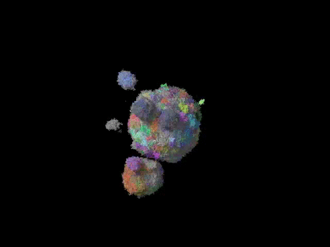
:::
::: {.column width="60%"}
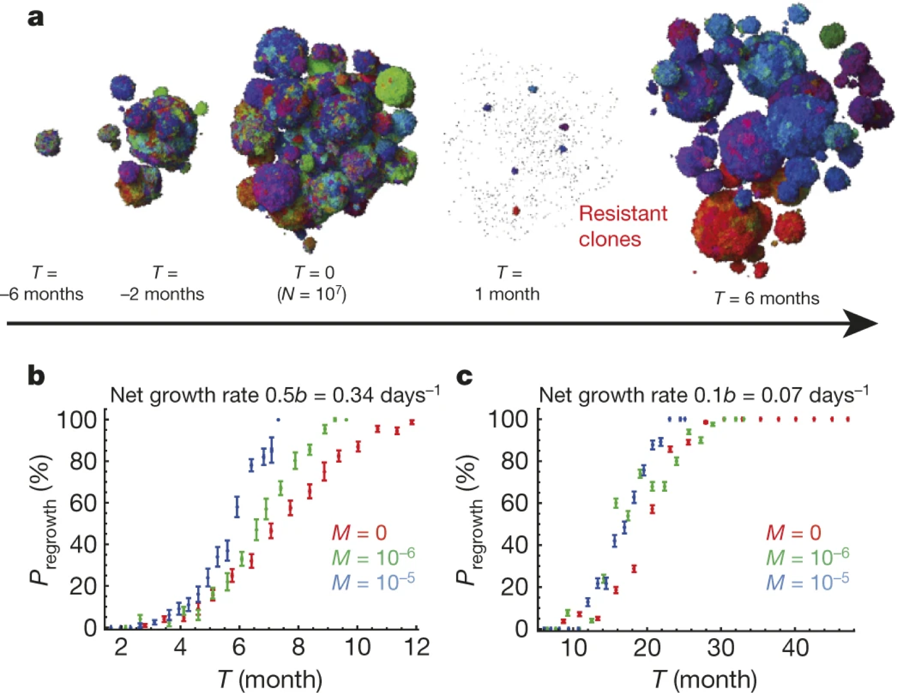
:::
::::

Waclaw et al. (2015): a 3D model of a growing tumour, with cells dividing into free space and occasionally migrating. Resistant clones are already present before treatment (**a**). The probability and timing of regrowth depend on the migration rate $M$ (**b, c**).

## Space matters for resistance too

Within a host, drug concentrations are **not uniform**: tissues, abscesses, biofilms, tumours.

. . .

- **Drug gradients speed up resistance.** Mutants can step up the gradient one mutation at a time, always next to an empty niche (Zhang et al. 2011; Hermsen et al. 2012).
- **Refuges** where the drug is weak keep a population alive, and that population keeps supplying mutants.
- Experiments: a slowly increasing drug concentration plus migration gives faster resistance (Perron et al. 2008; Bell & Gonzalez 2011).

## Gene flow and evolutionary rescue {.smaller}

Two habitats: an **untreated refuge** and a **treated** habitat, connected by migration $m$.

. . .

| Migration from refuge into treated habitat | Effect on rescue |
|---|---|
| brings sensitive cells in, so more mutants arise there | **helps** (demographic supply) |
| sends mutants back to the refuge, where they are at a disadvantage | **hurts** (loss of adapted lineages) |

. . .

So rescue is most likely at **intermediate** migration, and only if the environment deteriorates slowly enough (Tomasini & Peischl 2018, 2020; Kirkpatrick & Peischl 2013).


::: notes
This is the compressed version of ER deck slides 50-70. Pick one figure from Tomasini & Peischl to show here if time allows. Tumours: dispersal and cell turnover shape where resistant clones arise and how diverse a tumour is (Waclaw et al. 2015).
:::

## Experiment 1: yeast in a salt gradient {.smaller}

:::: {.columns}
::: {.column width="50%"}
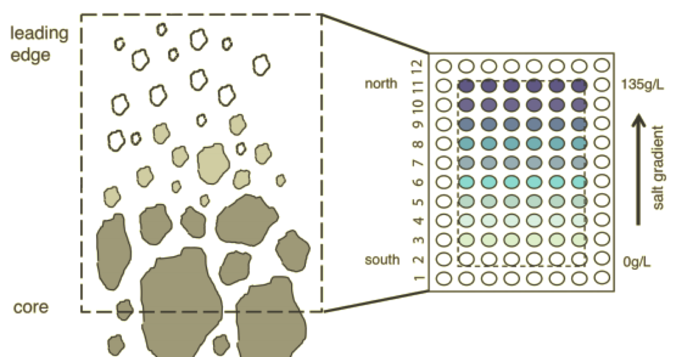{height="330"}
:::
::: {.column width="50%"}
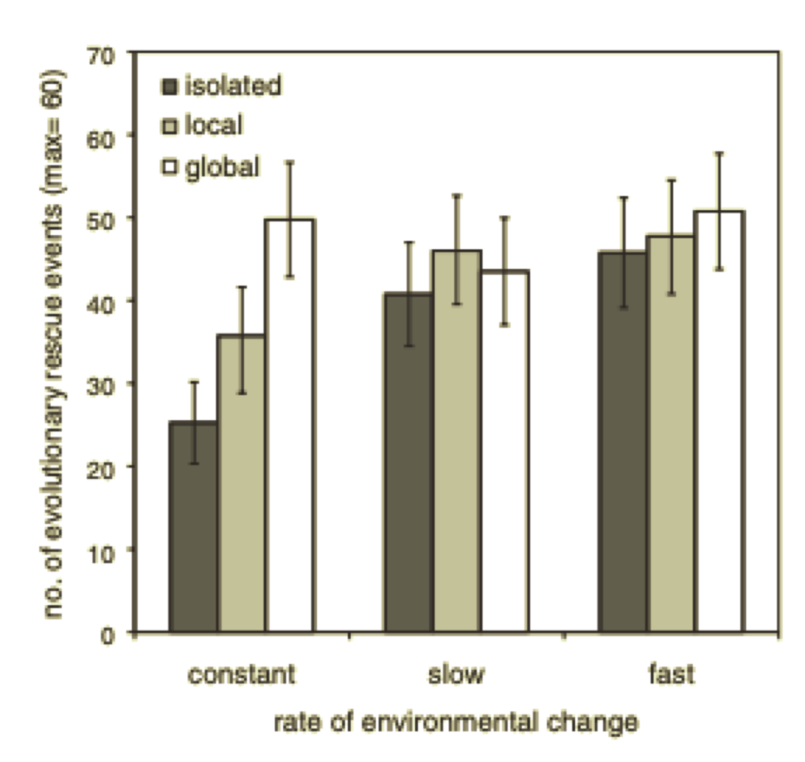{height="330"}
:::
::::

Yeast metapopulations on 96-well plates, with salt increasing from "south" to "north" (left). Populations were isolated or connected by local or global dispersal, and the environment deteriorated at different rates. Dispersal increased the number of rescued populations, most clearly in the "constant" treatment (right; Bell & Gonzalez 2011).

## Experiment 2: bacteria and an antibiotic sink {.smaller}

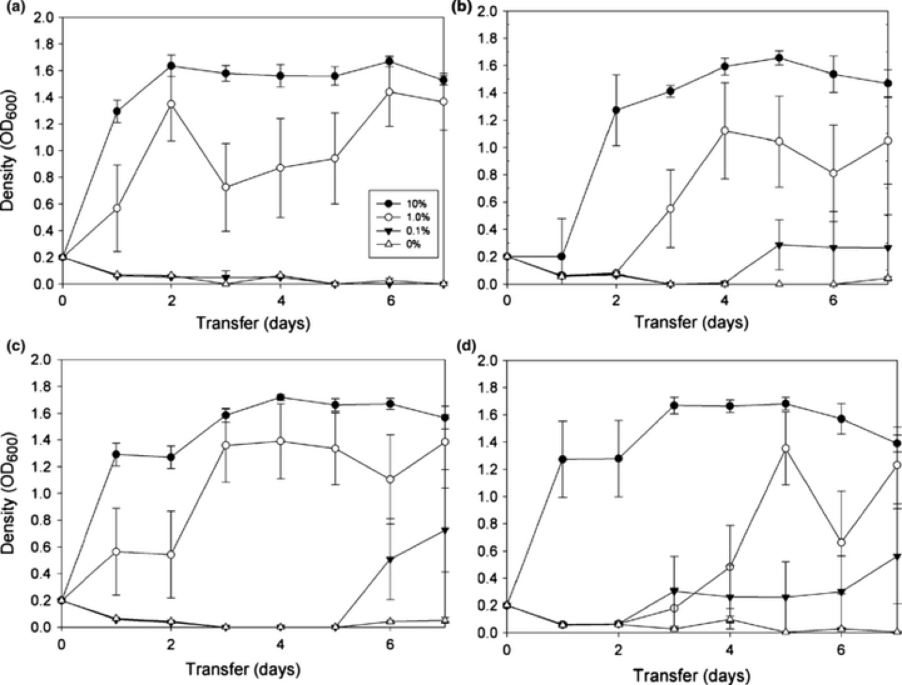{fig-align="center" height="400"}

*Pseudomonas aeruginosa* in an antibiotic "sink", receiving immigrants from an untreated source at rates from 0% to 10% (symbols); the panels differ in how the antibiotic concentration increased. Higher immigration and a slow increase in antibiotic concentration gave faster resistance evolution (Perron et al. 2008).

## A two-habitat model of rescue {.smaller}

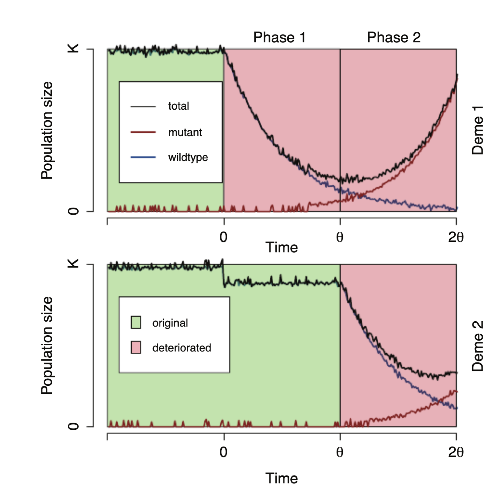{fig-align="center" height="350"}

Deme 1 deteriorates at time 0 and deme 2 at time $\theta$, connected by migration. A rescue mutation is beneficial in the deteriorated habitat and harmful in the original one. Its fate is a **two-type branching process** (Tomasini & Peischl 2018).

## Rescue peaks at intermediate migration {.smaller}

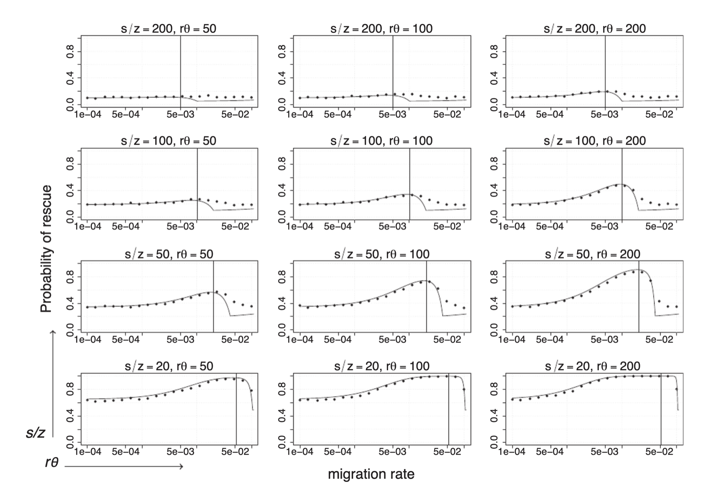{fig-align="center" height="370"}

Rescue probability against migration rate (points: simulations; lines: branching-process theory). When the environment deteriorates slowly across habitats, the curve has a **maximum**: some gene flow helps, too much swamps the mutants.

## Many habitats, and continuous space {.smaller}

:::: {.columns}
::: {.column width="50%"}
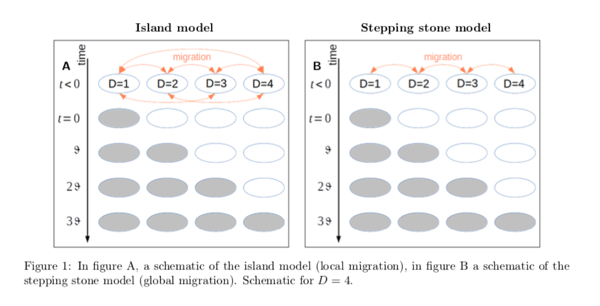{height="140"}
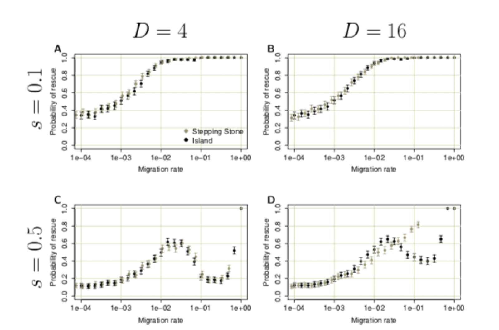{height="200"}

Island vs. stepping-stone migration between $D$ demes (Tomasini & Peischl, preprint, doi 10.1101/2020.10.29.360842).
:::
::: {.column width="50%"}
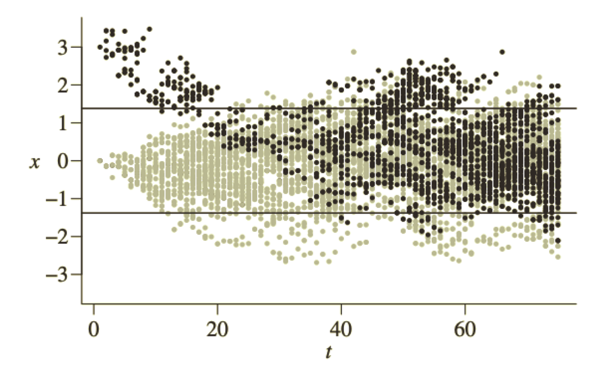{height="330"}

Continuous space: an individual-based simulation with a moving environmental boundary (Kirkpatrick & Peischl 2013). Migration has to be **fine-tuned** to the speed of environmental change.
:::
::::

## Inside a tumour: gradients from blood vessels {.smaller}

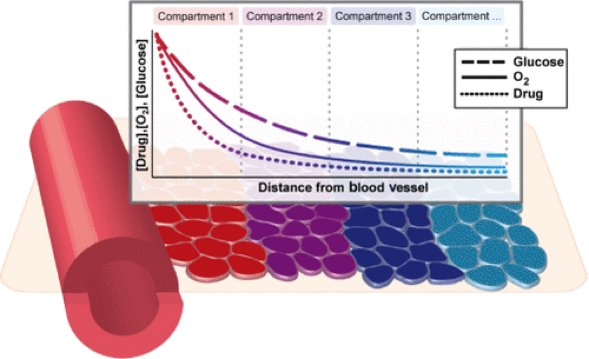{fig-align="center" height="370"}

Drug, oxygen and glucose fall off with distance from a blood vessel, so cells in different compartments experience different selection (doi 10.4137/CIN.S19338). Every tumour is a structured population with built-in refuges.

# Part 2 · Models meet data {background-color="#2C3E50"}

## What we actually observe

Not $\beta$ and $\gamma$, but **case counts**: noisy, delayed, and incomplete.

The question during an outbreak: **is it growing or shrinking right now?** That is, is $R_t > 1$?

. . .

The naive estimate, $R_t \approx I_t / I_{t-\tau}$, raises three problems:

- What is the right $\tau$? Infectiousness is spread over time.
- Counts are random, so we need uncertainty.
- Reporting changes over time.

## Real-time $R_t$ in Switzerland, 2020–2021 {.smaller}

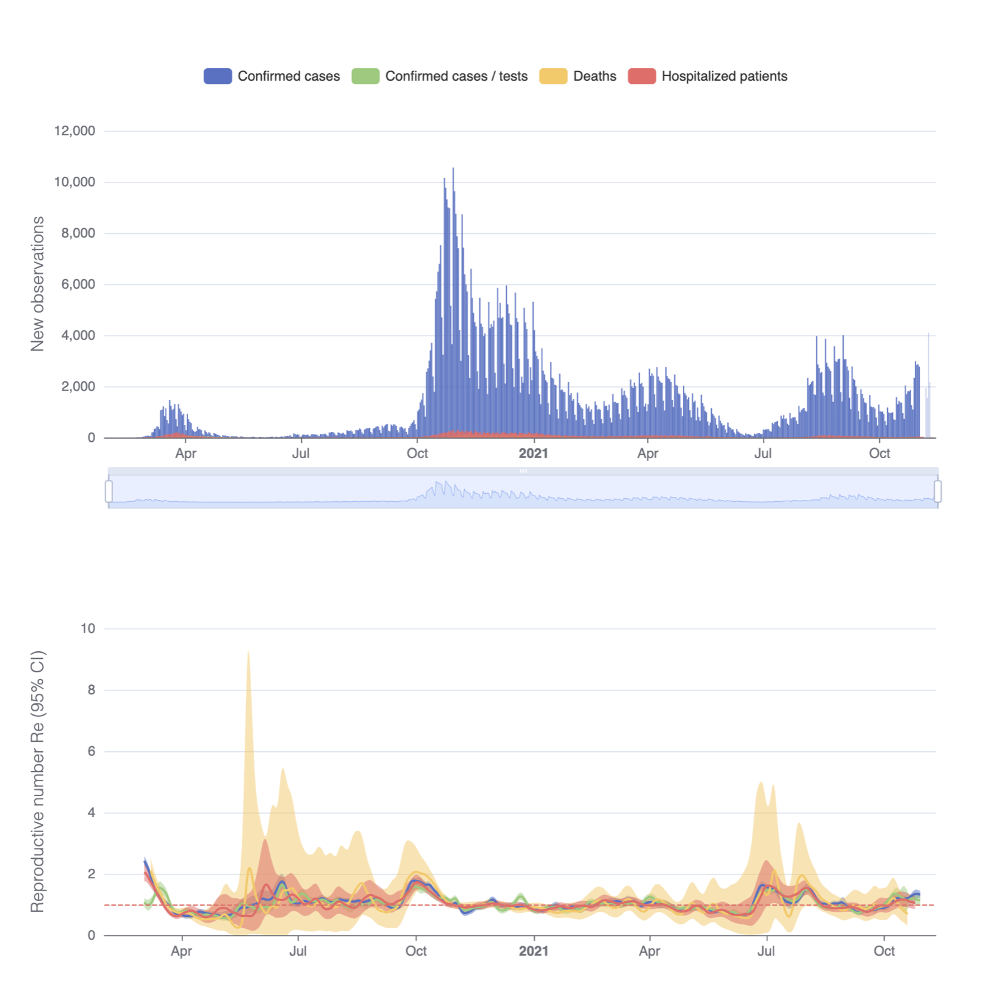{fig-align="center" height="390"}

The ETH Zürich group (Tanja Stadler, member of the Swiss COVID-19 Science Task Force) estimated $R_t$ daily from **cases, hospitalisations and deaths** separately (Huisman et al. 2022). Top: data. Bottom: $R_t$ for each data source.

## $R_t$ and interventions {.smaller .tall}

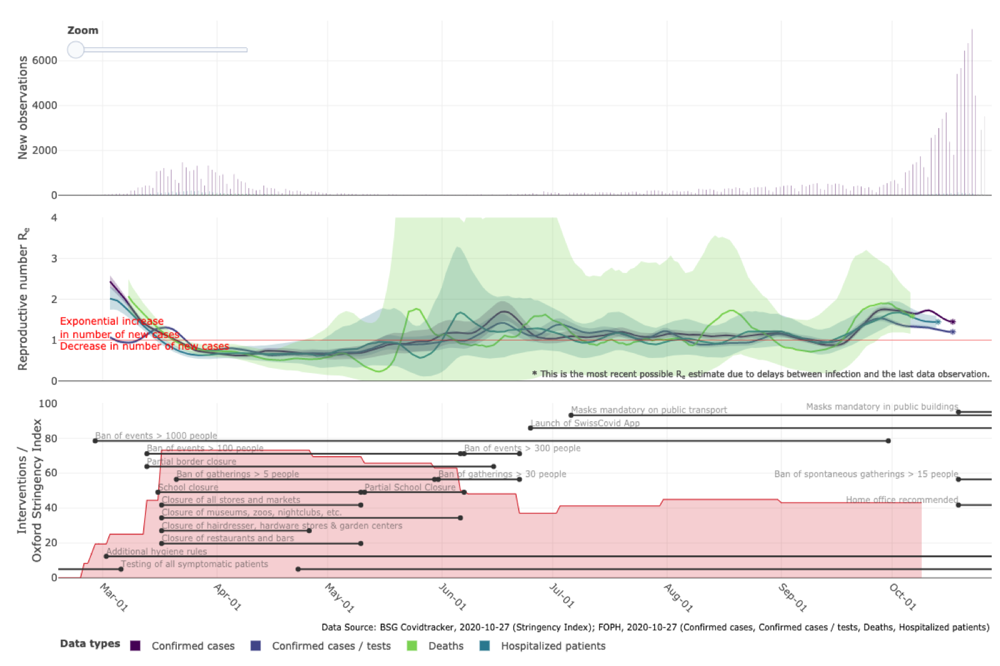{fig-align="center" height="500"}

$R_t$ fell **below 1** in spring 2020 as measures came in.

::: notes
Top: cases. Middle: Rt from each data stream (cases, hospitalisations, deaths). Bottom: the timeline of Swiss measures and the stringency index. The data streams agree on the trend but not on timing, because deaths lag cases by weeks.
:::

## The renewal equation

Infections today are caused by infections over the past days, weighted by the **serial interval** $w_s$:

$$
E[I_t] = R_t \,\Lambda_t, \qquad \Lambda_t = \sum_{s \ge 1} I_{t-s}\, w_s
$$

```{r}
#| label: si
#| fig-width: 11
#| fig-height: 3.3
si <- discr_si(0:14, 2.6, 1.5)
ggplot(data.frame(day = 0:14, w = si), aes(day, w)) +
  geom_col(fill = col_a, width = 0.8) +
  labs(x = "Days between symptom onsets (s)", y = expression(w[s]),
       title = "Influenza serial interval: mean 2.6 d, SD 1.5 d") +
  theme(plot.title = element_text(size = 18))
```

$\Lambda_t$ is the *total infectiousness* currently out there.

## Where the renewal equation comes from {.smaller}

Someone infected $s$ days ago is still infectious, to a degree that depends on $s$. Let $w_s$ be the fraction of their total onward transmission that happens on day $s$ (with $\sum_s w_s = 1$).

. . .

If each case causes $R_t$ new cases in total, the cases from day $t - s$ contribute

$$
I_{t-s} \cdot R_t \cdot w_s
$$

new cases today.

. . .

Sum over all past days:

$$
E[I_t] = R_t \sum_{s \ge 1} I_{t-s}\, w_s = R_t\, \Lambda_t
$$

. . .

In practice $w_s$ is approximated by the **serial interval**: the time between symptom onsets of infector and infectee, which we can observe.

## Where does $w_s$ come from? Viral shedding {.smaller}

:::: {.columns}
::: {.column width="55%"}
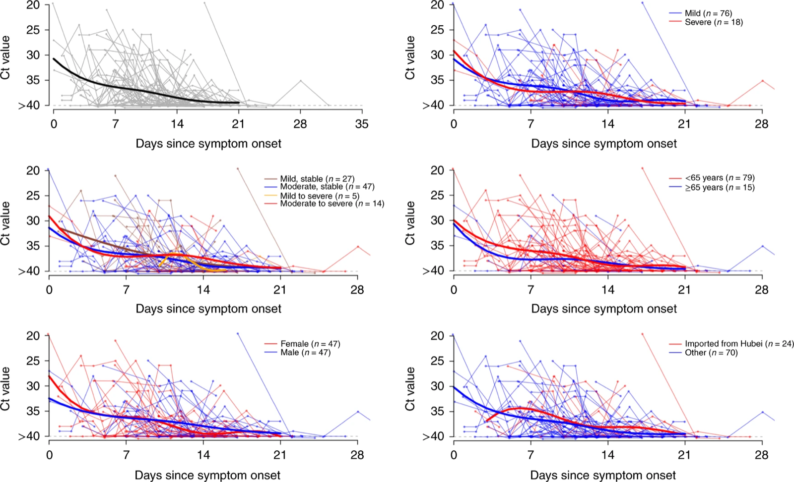
:::
::: {.column width="45%"}
He et al. (2020) measured SARS-CoV-2 viral load in throat swabs of 94 patients, as Ct values: lower Ct means more virus.

- Viral load is **highest at symptom onset** and declines over about 3 weeks.
- This is similar across age, sex and severity.
- So much transmission happens **around or before symptoms**, and isolating at symptom onset is too late.
:::
::::

## From transmission pairs to infectiousness profiles {.smaller}

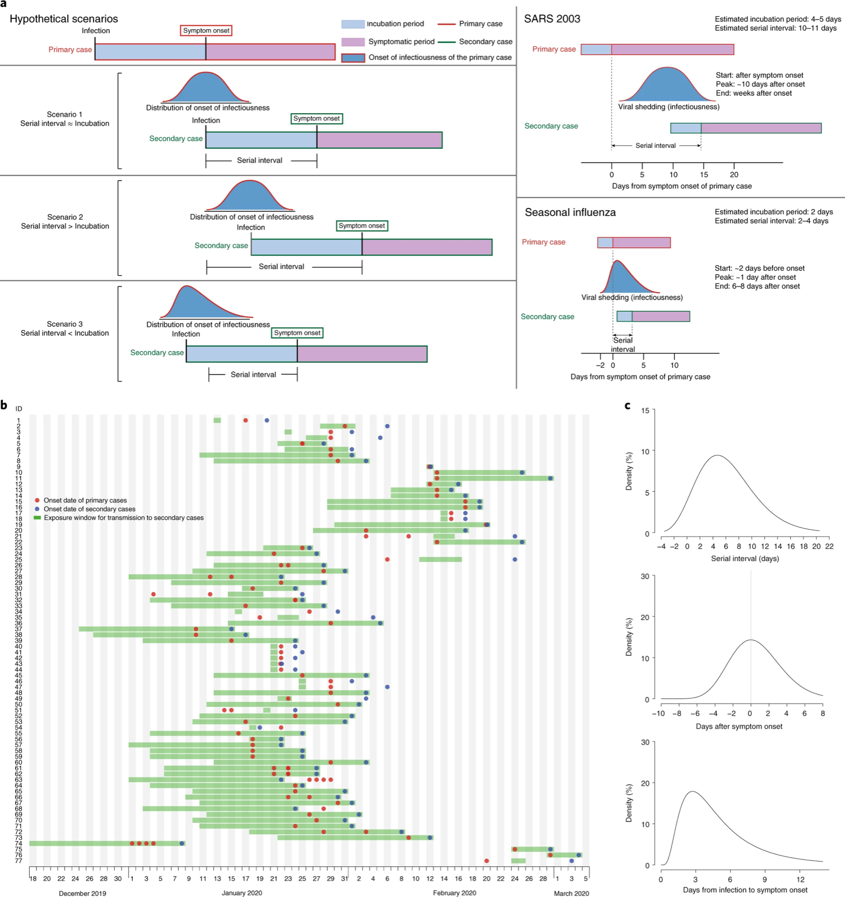{fig-align="center" height="390"}

He et al. (2020) combined 77 infector–infectee pairs with the incubation period to infer **when** infectors transmit. They estimated that about 44% of transmission happened before symptom onset. This is the $w_s$ that goes into the renewal equation.

## Bayesian estimation (Cori et al. 2013)

Assume $I_t \sim \text{Poisson}(R\,\Lambda_t)$, with $R$ constant over a window of $\tau$ days and a gamma prior with shape $a$ and scale $b$.

. . .

The posterior is again a gamma distribution, with **mean**

$$
\hat R_t = \frac{a + \sum_{s = t-\tau+1}^{t} I_s}{1/b + \sum_{s = t-\tau+1}^{t} \Lambda_s}
\;\approx\; \frac{\text{cases in the window}}{\text{infectiousness in the window}}
$$

. . .

That is the whole method behind `EpiEstim::estimate_R()`. Everything else is choosing $w_s$ and $\tau$.

## Deriving the posterior {.smaller}

**Likelihood:** each day in the window is Poisson with mean $R\Lambda_s$:

$$
L(R) = \prod_{s} \frac{(R\Lambda_s)^{I_s}\, e^{-R\Lambda_s}}{I_s!}
\;\propto\; R^{\sum I_s}\; e^{-R \sum \Lambda_s}
$$

. . .

**Prior:** gamma with shape $a$ and scale $b$: $\;\pi(R) \propto R^{a-1} e^{-R/b}$.

. . .

**Posterior** $\propto$ likelihood $\times$ prior:

$$
p(R \mid \text{data}) \;\propto\; R^{\,a + \sum I_s - 1}\; e^{-R\,(1/b + \sum \Lambda_s)}
$$

This is again a gamma distribution, with shape $a + \sum I_s$ and rate $1/b + \sum\Lambda_s$. Its mean is the formula on the previous slide.

. . .

**Bonus:** if only a constant fraction $\rho$ of cases is reported, every $I_s$ and every $\Lambda_s$ is multiplied by $\rho$, and $\rho$ cancels in $\sum I_s / \sum \Lambda_s$.

## A real outbreak: H1N1 in a school, 2009

```{r}
#| label: flu
#| fig-width: 11
#| fig-height: 5.2
data(Flu2009)
res <- estimate_R(Flu2009$incidence, method = "parametric_si",
                  config = make_config(mean_si = 2.6, std_si = 1.5))
Rdf <- res$R
Rdf$date <- Flu2009$incidence$dates[Rdf$t_end]
ggplot(Rdf, aes(date, `Mean(R)`)) +
  geom_ribbon(aes(ymin = `Quantile.0.025(R)`, ymax = `Quantile.0.975(R)`), fill = col_a, alpha = 0.3) +
  geom_line(linewidth = 1.5, colour = col_a) +
  geom_hline(yintercept = 1, linetype = "dotted") +
  labs(x = NULL, y = expression(R[t]), title = "7-day windows, 95% credible interval") +
  theme(plot.title = element_text(size = 18))
```

## Does it recover the truth? Test on a simulation

```{r}
#| label: truth
#| fig-width: 11
#| fig-height: 5.2
set.seed(42)
sim_epidemic <- function(N, beta, gamma, I0) {
  S <- N - I0; I <- I0; t <- 0; inf_t <- rep(0, I0); S_t <- c(0, S)
  while (I > 0) {
    a_inf <- beta * S * I / N; a_rec <- gamma * I
    t <- t + rexp(1, a_inf + a_rec)
    if (runif(1) < a_inf / (a_inf + a_rec)) {
      S <- S - 1; I <- I + 1; inf_t <- c(inf_t, t); S_t <- rbind(S_t, c(t, S))
    } else I <- I - 1
  }
  list(inf_t = inf_t, S_t = S_t)
}
N <- 2000; gamma <- 0.2; R0 <- 2
sim  <- sim_epidemic(N, R0 * gamma, gamma, 10)
days <- 0:ceiling(max(sim$inf_t))
inc  <- as.vector(table(factor(floor(sim$inf_t), levels = days)))
truth <- data.frame(day = days, Rt = R0 * approx(sim$S_t[, 1], sim$S_t[, 2], xout = days,
                                                  method = "constant", rule = 2)$y / N)
est_with <- function(m, sd, label) {
  T_end <- length(inc)
  r <- estimate_R(inc, method = "parametric_si",
                  config = make_config(mean_si = m, std_si = sd,
                                       t_start = 2:(T_end - 6), t_end = 8:(T_end)))$R
  data.frame(day = r$t_end - 4, mean = r$`Mean(R)`,
             lo = r$`Quantile.0.025(R)`, hi = r$`Quantile.0.975(R)`, si = label)
}
est <- rbind(est_with(5, 5, "correct SI (mean 5 d)"), est_with(2.6, 1.5, "wrong SI (mean 2.6 d)"))
est <- filter(est, day <= 50)
ggplot(est, aes(day, mean, colour = si, fill = si)) +
  geom_ribbon(aes(ymin = lo, ymax = hi), alpha = 0.2, colour = NA) +
  geom_line(linewidth = 1.3) +
  geom_line(data = filter(truth, day <= 50), aes(day, Rt), inherit.aes = FALSE, linewidth = 1.5) +
  geom_hline(yintercept = 1, linetype = "dotted") +
  scale_colour_manual(values = c(col_a, col_b), aesthetics = c("colour", "fill")) +
  labs(x = "Day", y = expression(R[t]), colour = NULL, fill = NULL,
       title = "Gillespie SIR, N = 2000, R0 = 2, mean generation time 5 days; black = true Rt") +
  theme(plot.title = element_text(size = 18), legend.position = "top")
```

## Why the serial interval matters so much {.smaller}

The data really tell us the **growth rate** $r$. Turning $r$ into $R$ needs the generation interval (Wallinga & Lipsitch 2007). For an exponential interval with mean $T_g$:

$$
R = 1 + r\,T_g
$$

. . .

- The same growth with a **shorter** assumed interval gives an $R$ **closer to 1**.
- This matters most when $R$ is far from 1, i.e. early on and after interventions.
- Serial intervals are themselves estimated from transmission pairs, with their own uncertainty.

## Deriving $R = 1 + r\,T_g$ {.smaller}

During exponential growth, $I_t = I_0 e^{rt}$. Put this into the renewal equation (continuous time, generation interval density $g$):

$$
I_0 e^{rt} = R \int_0^\infty I_0 e^{r(t - \tau)}\, g(\tau)\, d\tau
\quad\Rightarrow\quad
1 = R \int_0^\infty e^{-r\tau} g(\tau)\, d\tau
$$

. . .

For an exponential generation interval, $g(\tau) = e^{-\tau/T_g}/T_g$:

$$
\int_0^\infty e^{-r\tau}\, \frac{e^{-\tau/T_g}}{T_g}\, d\tau = \frac{1}{1 + rT_g}
\quad\Rightarrow\quad
R = 1 + r\,T_g
$$

. . .

Example: cases double every 5 days, so $r = \ln 2/5 \approx 0.14$/day. With $T_g = 5$ days, $R \approx 1.7$; with $T_g = 2.6$ days, $R \approx 1.4$. **Same data, different $R$.**

## Other pitfalls {.smaller}

| Issue | Effect on $\hat R_t$ |
|---|---|
| **Window length** $\tau$ | short: noisy; long: smooth but late |
| **Constant under-reporting** (only a fraction $\rho$ of cases seen) | cancels: $\rho$ appears in numerator and denominator |
| **Changing reporting** (more testing) | looks like growth: $\hat R_t$ biased upwards |
| **Reporting delays** | the most recent days are incomplete, so $\hat R_t$ looks like it is falling |
| **Imported cases** | counted as local transmission: $\hat R_t$ too high |

. . .

Rule of thumb: **test your method on simulated data where you know the truth** before trusting it on real data.

## Beyond case counts

- **Hospitalisations and deaths:** more reliable reporting, but a long delay after infection. Estimates lag by 2–3 weeks.
- **Wastewater:** independent of testing behaviour, but needs calibration.
- **Pathogen sequences:** the shape of the transmission tree carries information on $R_t$.
  - Birth–death models fitted to phylogenies, e.g. the birth–death skyline (Stadler et al. 2013).
  - Lineages that branch fast mean a high $R_t$.
  - This is the branching process from Day 1, read backwards from data.

## Trees as data: birth–death models {.smaller}

:::: {.columns}
::: {.column width="50%"}
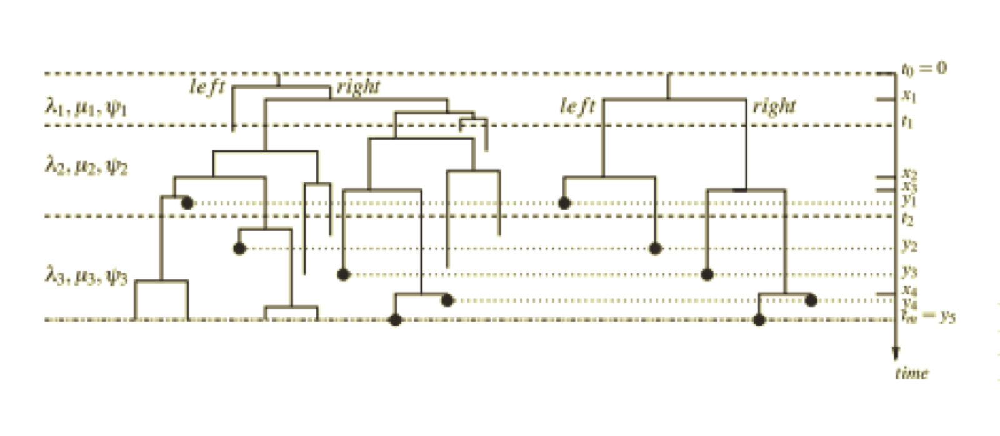

**Birth–death skyline:** transmission ($\lambda$), becoming non-infectious ($\mu$) and sampling ($\psi$) rates change between time intervals. Fitting this to a sampled phylogeny gives $R_e = \lambda/\mu$ through time (Stadler et al. 2013).
:::
::: {.column width="50%"}
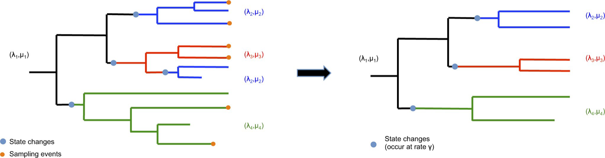

**Multi-type:** lineages can switch between types (e.g. locations or risk groups), each with its own rates (Barido-Sottani et al. 2020).
:::
::::

This is the branching process from Day 1, run backwards: from the tree to the rates.

## Transmissible cancer in Tasmanian devils {.smaller}

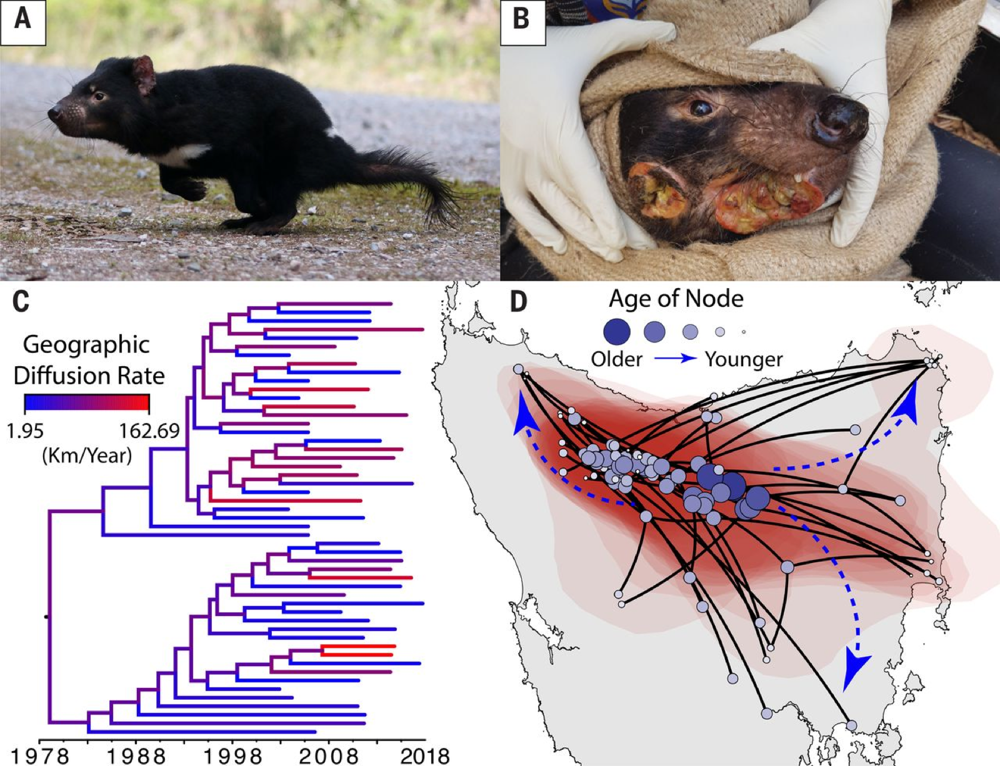{fig-align="center" height="390"}

Devil facial tumour disease spreads by **biting**: the cancer cells themselves are the pathogen. Patton et al. (2020) built a phylogeny from tumour genomes (**C**) and traced its spread across Tasmania (**D**).

## From emergence to endemism {.smaller}

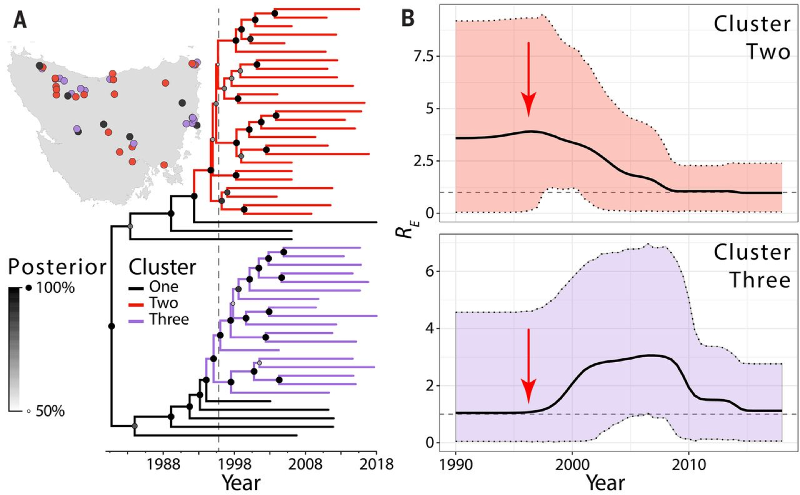{fig-align="center" height="370"}

Birth–death phylodynamics on the tumour tree: in both clusters $R_e$ was around 3–4 early on and has since **dropped to about 1**. This suggests the disease is becoming endemic rather than driving devils to extinction (Patton et al. 2020).

## Which interventions worked? The question {.smaller}

:::: {.columns}
::: {.column width="50%"}
Haug et al. (2020) used $R_t$ itself as **data**:

- **Interventions:** 6,068 coded measures in 79 territories, March–April 2020 (CCCSL dataset; Desvars-Larrive et al. 2020).
- **Outcome:** $R_t$ estimated from case counts in each territory.
- **Methods:** case-control analysis, LASSO regression, random forests and transformers. Each assigns every intervention an effect $\Delta R_t$.

The hard part: many measures start at almost the same time, so their effects are entangled.
:::
::: {.column width="50%"}
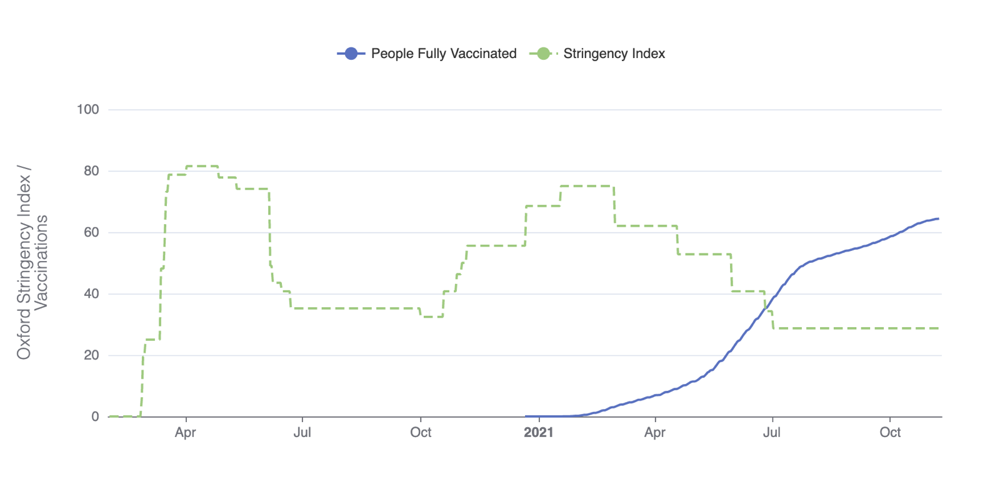

Example input: the Oxford Stringency Index and vaccination coverage over time.
:::
::::

## Which interventions worked? The answer {.smaller .tall}

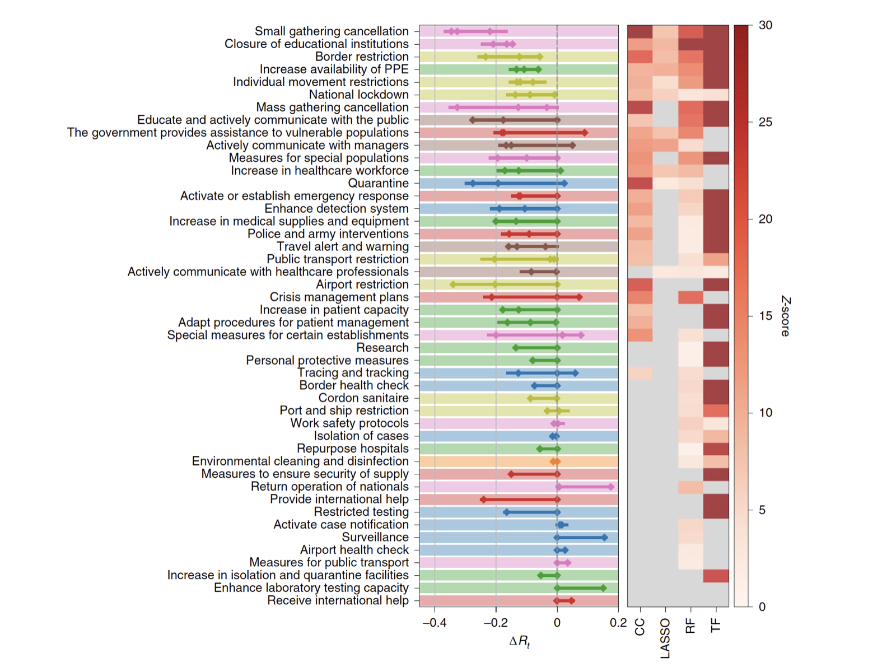{fig-align="center" height="560"}

::: notes
Left: estimated effect ΔRt of each measure (most effective at the top). Right: agreement between the four methods (case-control, LASSO, random forest, transformer). Cancelling small gatherings, closing schools and border restrictions ranked among the most effective. Rankings depend on method and timing.
:::

## Summary {.smaller}

1. **Local contacts:** spread is a wave at constant speed $c = 2\sqrt{rD}$, and cases grow like $t^2$, not $e^{rt}$.
2. **Local contacts raise the threshold:** $R_0 > 1$ is not enough on a grid (percolation).
3. **Space and resistance:** gradients and refuges speed up resistance; migration has an optimum.
4. **$R_t$ from data:** renewal equation; $\hat R_t \approx$ cases ÷ infectiousness in the window.
5. **The serial interval is an assumption, not a detail:** $R = 1 + rT_g$.

**Tutorials:** T5 (spatial), T6 ($R_t$)

## Pitch 3 — First result (2 min per team)

1. **One figure** and what it shows
2. **Did it match your prediction from Pitch 2?** If not, why not?
3. **What is still missing** for next week, and where are you stuck?

. . .

**Project hooks from today:** long-range jumps · ring vs. random vaccination on a grid · a tumour with resistant cells on a grid · $R_t$ for an EpiEstim dataset (`SARS2003`, `Measles1861`, `Smallpox1972`, `Flu1918`, `mers_2014_15`) · simulated lockdown, and how late EpiEstim notices it

## References {.smaller .scrollable}

- Barido-Sottani J, Vaughan TG, Stadler T (2020). A multitype birth–death model for Bayesian inference of lineage-specific birth and death rates. *Syst Biol* 69:973–986.
- Desvars-Larrive A et al. (2020). A structured open dataset of government interventions in response to COVID-19. *Sci Data* 7:285.
- Haug N et al. (2020). Ranking the effectiveness of worldwide COVID-19 government interventions. *Nat Hum Behav* 4:1303–1312.
- He X, Lau EHY, Wu P, et al. (2020). Temporal dynamics in viral shedding and transmissibility of COVID-19. *Nat Med* 26:672–675.
- Huisman JS et al. (2022). Estimation and worldwide monitoring of the effective reproductive number of SARS-CoV-2. *eLife* 11:e71345.
- Patton AH et al. (2020). A transmissible cancer shifts from emergence to endemism in Tasmanian devils. *Science* 370:eabb9772.
- Bell G, Gonzalez A (2011). Adaptation and evolutionary rescue in metapopulations experiencing environmental deterioration. *Science* 332:1327–1330.
- Cori A, Ferguson NM, Fraser C, Cauchemez S (2013). A new framework and software to estimate time-varying reproduction numbers during epidemics. *Am J Epidemiol* 178:1505–1512.
- Fisher RA (1937). The wave of advance of advantageous genes. *Ann Eugen* 7:355–369.
- Hermsen R, Deris JB, Hwa T (2012). On the rapidity of antibiotic resistance evolution facilitated by a concentration gradient. *PNAS* 109:10775–10780.
- Kirkpatrick M, Peischl S (2013). Evolutionary rescue by beneficial mutations in environments that change in space and time. *Phil Trans R Soc B* 368:20120082.
- Perron GG, Gonzalez A, Buckling A (2008). The rate of environmental change drives adaptation to an antibiotic sink. *J Evol Biol* 21:1724–1731.
- Stadler T, Kühnert D, Bonhoeffer S, Drummond AJ (2013). Birth–death skyline plot reveals temporal changes of epidemic spread in HIV and hepatitis C virus (HCV). *PNAS* 110:228–233.
- Tomasini M, Peischl S (2018). Establishment of locally adapted mutations under divergent selection. *Genetics* 209:885–895.
- Tomasini M, Peischl S (2020). When does gene flow facilitate evolutionary rescue? *Evolution* 74:1640–1653.
- Waclaw B, Bozic I, Pittman ME, Hruban RH, Vogelstein B, Nowak MA (2015). A spatial model predicts that dispersal and cell turnover limit intratumour heterogeneity. *Nature* 525:261–264.
- Wallinga J, Lipsitch M (2007). How generation intervals shape the relationship between growth rates and reproductive numbers. *Proc R Soc B* 274:599–604.
- Zhang Q, Lambert G, Liao D, et al. (2011). Acceleration of emergence of bacterial antibiotic resistance in connected microenvironments. *Science* 333:1764–1767.
